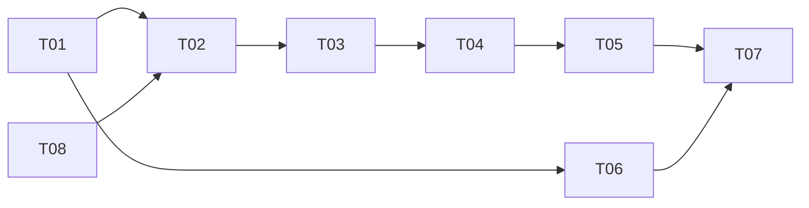

# 计划：通过 Python MCP 操作当前游戏角色
最后修改时间: 2026-11-01 20:13:14

## 审查状态

Accepted。方案修订 3。用户于 2026-10-31 明确要求“开始按计划实现”，总计划及八个 task 方案据此接受并进入 Implementation。授权包含必要代码、依赖、构建、开发检查，以及通过 codex-cli 向两个已核对副手分派和接收报告；不包含 Git 提交或发布。

当前为 Implementation 阶段性收尾：T01、T08、T02、T03、T04、T05、T06 局部实现已接受，T07 未分配，整体 Verification 未开始。2026-11-01 本次只更新文档，不重启开发、构建或游戏验证。全部已完成项、实机待办及 A01 至 A08 状态见[验证清单](../verification/20261031-ai-character-mcp.md)。

## 意图依据

- [意图与 MCP 全景](../intent/20261031-ai-character-mcp.md)。本计划交付 A01 至 A08 对应场景；全景中的其余能力属于后续演进。
- 用户确认当前窗口角色、完整首版能力、人工立即接管，并要求“支持使用 python 实现 mcp, 开始计划”。
- 工作区 `D:\SourceCodes\opensource\mir2x`；计划调查基线 `b1ddda8`。最初调查时仅有未跟踪的 `docs/`；实现后的源码、构建及检查版本见执行登记和阶段性收尾，不再使用该初始状态描述当前工作区。

## 技术设计与决策

### 1. 调查结论与依据

| 已核对事实 | 依据 | 设计影响 |
| --- | --- | --- |
| SDL 事件与游戏网络都由客户端主循环轮询 | `client/src/client.cpp` 的 `eventDelay/processEvent` | IPC 使用独立异步 ASIO 上下文，由同一主线程限额轮询，不引入后台游戏对象访问 |
| 新动作会覆盖已有动作队列，返回 true 不代表完成 | `client/src/myhero.cpp` 的 `emplaceAction/brakeMove` | 一次只运行一个改变游戏状态的操作；人工接管使旧队列和旧控制代次失效 |
| GUI 会先消费点击和键盘事件 | `client/src/processrun.cpp` 的 `processEvent` | 人工输入检测置于 GUI 分派前，不能仅修改移动处理分支 |
| Process 切换清空响应回调，但响应 ID 会复用，迟到未知响应会抛错；记录的 timeout 未被轮询处理 | `client/src/client.hpp` 的 `send`、`client.cpp` 的 `initASIO/switchProcess` | 补充单调响应 ID、作用域与超时管理，迟到响应不调用旧对象、不导致客户端退出 |
| NPC 对话、出售和文本输入均通过动态事件路径及标签驱动 | `gui/npcchatboard/`、`inventoryboard.cpp`、`processrunnet.cpp` 的 `SM_STARTINPUT` | 只允许选择当前面板生成的句柄，不能让 MCP 传任意 NPC 脚本事件 |
| 拾取、使用物品及可堆叠商品购买缺少统一的相关完成回执 | `server/src/playernet.cpp` 的 `net_CM_PICKUP/net_CM_CONSUMEITEM/net_CM_BUY` | 保留现有游戏协议，按结果证据分类；不足以判定时返回 unknown，不能自动重试 |
| 当前 consume 分支实际支持技能书和药品 | `server/src/playernet.cpp` 的 `net_CM_CONSUMEITEM` | 本次 use_item 支持这些正常可用类型，其余返回 unsupported_item_type |
| 玩家交易有双方报价、锁定、完成回执；GUI 有物品暂存 | `gui/directtradeboard/`、`processrunnet.cpp` | 抽取 UI 与桥接共用的事务入口，沿用物品预留和恢复逻辑 |
| 拍卖成功通过系统投递交付物品，领取有独立回执 | `gui/auctionboard/`、`gui/friendchatboard/friendchatboard.cpp` | 拍卖购买与投递领取为两个操作，不能把买到等同于进入背包 |
| 主程序中的部分全局对象不依赖析构释放 | `client/src/main.cpp` | 在主循环退出及异常退出路径显式关闭桥接，启动时验证遗留实例信息 |
| 现有 MSYS2 构建记录可复用，但未完成新源码 GUI 登录进图验证 | [Windows 开发环境](../../readme/development/windows-development.md) | 实现后先证明基础登录进图，再做 MCP 真实客户端场景 |

本机 Windows Python 为 3.13.11，uv 为 0.11.16；与构建脚本使用的 MSYS2 Python 分开。2026-10-31 计划调查时 Python `mcp` 尚未安装；T06 已在项目 .venv 锁定安装并验证 `mcp==2.3.0`。官方入口为 `from mcp.server import MCPServer`，支持 `@server.tool()` 和 `server.run(transport="stdio")`。不沿用旧版 FastMCP 示例。

来源：[PyPI 元数据](https://pypi.org/pypi/mcp/2.3.0/json)、[官方版本 README](https://github.com/modelcontextprotocol/python-sdk/blob/v2.3.0/README.md)、[MCPServer 实现](https://github.com/modelcontextprotocol/python-sdk/blob/v2.3.0/src/mcp/server/mcpserver/server.py)。这些是最初 API 调查依据；已完成的安装、76 项 SDK/fake 检查及至 T04 的真实 C++ 只读握手记录在各 task 和验证清单，最终 T05 二进制 stdio 仍待验证。

### 2. 结构与目录

```text
AI 宿主 -- MCP stdio --> Python MCPServer
                            |
                     本机 TCP / 认证 / JSON
                            |
          C++ AiBridgeTransport + AiBridgeController
                            |
             主线程中的游戏与 GUI 共用动作入口
                            |
                 现有游戏消息 / 现有服务端
```

- C++ 新模块：`client/src/aibridge/`，分为 transport、protocol、controller、snapshot、actions、economy；对游戏对象的访问集中在主线程适配层。
- 协议契约：`contracts/ai-bridge/v1/`，包含 JSON Schema、脱敏样例和正常/错误契约样本。接口版本独立于游戏服务端版本。
- Python 项目：`tools/mir2x-mcp/`，采用 `pyproject.toml`、`uv.lock`、`src/mir2x_mcp/` 和 `tests/`；运行依赖固定 `mcp==2.3.0`，数据模型显式声明 Pydantic v2 依赖并锁定实际解析版本。只用 MCP SDK，不再引入另一个 FastMCP 框架。
- 虚拟环境在 `tools/mir2x-mcp/.venv/`，缓存、认证文件、审计日志和测试运行目录在仓库根 `.runtime/`；实现时补充忽略规则。凭据不放入下载制品、不放用户全局 MCP 配置的明文参数。
- C++ JSON 使用固定 vcpkg registry baseline 的 `nlohmann-json`；T01 已安装 3.12.0#2 并完成编译。只给需要的 target 链接 `nlohmann_json::nlohmann_json`。复用现有 ASIO、tinyxml2 和 Catch2。
- 不改游戏网络报文、数据库结构或服务端业务。本次必要的客户端响应回调修复见第 8 节；若实现中发现必须修改协议才能满足范围，先回到 Plan 调整，不能静默扩项。

### 3. 启用、实例选择与认证

客户端参数：`--enable-ai-bridge`、`--ai-bridge-dir=<绝对路径>`、`--ai-policy=<绝对路径>`。未启用时不监听、不创建凭据，原控制路径仍需回归。启用时后两个参数必填，当前由用户或启动配置传入 `.runtime/ai-bridge/` 和本地策略路径；正式启动辅助脚本仍为 T07 待办。

1. 仅绑定 `127.0.0.1:0`，由系统分配端口；不提供远程监听参数。生成随机 `instance_id` 和 256 位随机令牌，Windows 用系统随机源，Linux 用系统安全随机源。
2. 创建 `<instance_id>.json`，内容为版本、实例 ID、PID、启动时间、端口、构建标识和令牌。Windows 使用受保护 DACL，仅当前用户与 SYSTEM 可读写；POSIX 使用目录 0700、文件 0600。拒绝重解析点/符号链接，无法保证权限时不启用桥接。
3. Python 从显式实例文件或配置的发现目录选择实例。唯一存活实例可连接；存在多个时返回 ambiguous_instance，要求配置明确的实例 ID，不能自行挑窗口或切换角色。文件路径不是工具参数，AI 无法读任意路径。
4. 首帧为带协议版本、实例 ID、令牌的 hello。认证失败关闭连接，不回显令牌。只允许一个已认证 MCP 连接；最多四个待认证连接，三秒未完成认证关闭。
5. 连接仅取得查询权限。进入 RUN 后，由用户点击窗口内“开启 AI 控制”才允许动作；控制面板显示角色、授权范围和暂停原因。MCP 不提供开启、恢复或修改策略的工具。
6. 显式关闭时移除本实例文件；异常遗留文件只能由握手判活。PID 和时间不能单独作为存活或身份凭据，不按目录通配符清理其他实例。

同一 OS 用户可读取凭据；此设计防止意外暴露和其他用户读取，不声称隔离同一用户启动的恶意进程。

### 4. IPC 契约与数据模型

- 每帧为 4 字节大端长度 + UTF-8 JSON。请求最大 64 KiB，响应最大 1 MiB；先验证长度再分配内存。拒绝重复 JSON 键、未知字段、错误类型、非有限数字、深度超过 16、越界数值和未知方法。
- 请求统一包含 `v:1`、`id`、`method`、`params`；动作还必须包含 `request_id`、`context` 和 `timeout_ms`。`id` 只匹配一次 IPC 请求；`request_id` 是调用方提供的 UUID，用于动作去重。
- `context` 为 `instance_id/session_id/world_epoch/control_epoch`。session 绑定本次已登录角色；进入/离开 RUN、换角色使 session 失效，地图变化递增 world_epoch，暂停和重新授权递增 control_epoch。旧上下文在入队和执行前都被拒绝。
- 所有 UID、金币、拍卖 ID、序号计数器及可能超过 JS 安全整数的值使用十进制字符串。格子坐标、item_id、seq_id、count 使用有限范围整数；其上限取现有协议/GUI 能表示的更严格值，负数与溢出拒绝。
- 结果包包含 `ok`、`data` 或 `error {code,message,details}`、当前 `context`。业务错误使用稳定错误码，中文 message；认证秘密、密码与原始 XML 不进入错误详情。
- 公共错误码固定包括 invalid_argument、unauthorized、version_mismatch、ambiguous_instance、not_in_game、paused、stale_context、stale_target、stale_cursor、busy、policy_denied、budget_exceeded、duplicate_conflict、ledger_full、unreachable、stalled、timeout、transport_lost、unsupported_item_type、unsupported_skill、economic_uncertain；具体游戏错误保留受控的 server_code，不暴露任意内部异常文本。
- 快照包含 `snapshot_seq`、`observed_at`、`source:"client"`、`coverage`；未知字段为 null 并附 `unavailable_fields`，不能用 0 假装未知值。位置同时给出当前动画位置与动作终点，地图含真实 map_uid。
- 列表每页最多 100 条，游标绑定完整冻结快照及过滤条件，每类保留最近两份。实时状态改变不改写旧页；快照被淘汰、scope/过滤不匹配或游标非法才返回 stale_cursor。旧页不恢复已失效动作句柄。每份最多 8192 行，超出明确 unavailable；地形查询最多 33×33 格，只提供客户端加载的地形，不附送其他地图或隐形对象。
- 事件环保留最近 1024 条，以 event_seq 查询；超出保留范围明确 `gap:true`，宿主重取快照。事件为单独工具/资源查询，本次不实现后台订阅或服务端主动推送 MCP 通知。
- 主循环顺序为游戏网络处理 → 人工事件 → 桥接收包/调度 → 操作观察。每轮桥接最多处理 16 个 ASIO handler 和 8 个请求，目标预算 2 ms，预算是轮询边界的软上限；单个 handler 也须有界。待处理最多 64 个请求、出站缓冲最多 2 MiB，超额返回 busy 或关闭慢读连接。不会等待 socket 或任务完成。
- 每连接每秒最多 20 个请求；停止请求使用独立优先槽，正常队列和去重账本满时仍可停止。心跳 2 秒，连续 6 秒无认证连接活动则暂停；MCP 进程崩溃、断开均停止继续发起动作。

### 5. 控制权、操作生命周期和结果

**控制状态**：disabled → read_only → active；游戏窗口内的人工操作、断线、死亡、离开 RUN、换图或 stop 进入 paused。重新进入地图不会自动继续。用户在窗口点击恢复后建立新 control_epoch；必须再次读取上下文再调用动作。

冲突输入按 SDL 事件实际到达顺序处理：游戏窗口内鼠标按下、滚轮、非重复按键按下和文本输入均视为人工操作，先暂停并清除 AI 意图，再把原事件交给原界面；仅鼠标移动、按键释放、重绘和尺寸变化不触发接管。控制面板开启/恢复按钮的专属事件由面板先处理，不能刚开启就因同一点击暂停。单独失焦不暂停，使用户可以切换到 AI 宿主发出指令；重新聚焦也不改变既有控制状态，实际游戏输入仍立即接管。

停止会清除 AI 的移动、攻击/跟随焦点和待发动作，调用现有 brakeMove 等必要入口；当前动画可能完成半步，已到服务器的消耗或交易不能撤回。人工接管先停止旧 AI，再执行人工事件，不能清掉刚生成的人工动作。显示“暂停 AI”按钮，提供 `game_stop`，不占用现有技能快捷键。

**操作状态**：`accepted → running → succeeded/failed/cancelled/unknown`。响应立即返回 operation_id，不让 MCP 工具一直挂到长动作完成；用 `game_get_operation` 观察。一次最多一个改变游戏状态的运行操作；不隐式排队第二个操作。直接交易的会话可跨多个已完成步骤，但会阻止移动等不兼容动作。

- `succeeded` 必带 `completion_scope` 和 evidence。`server_ack` 表示有明确回执；`observed_postcondition` 表示只观察到约定状态；`client_state` 表示本地面板或模式改变。三者不能互换。
- `failed` 表示前置校验拒绝或明确的服务端失败；`cancelled` 仅用于确定未提交的动作/已停止的本地持续动作。提交后遇到中断且无法确认结果时用 unknown，并记录 `cancel_requested` 和 `side_effects_possible`。
- 缺失回执不能按等待时间推断成功。超时上限：移动 30 秒、普通攻击连续操作 30 秒、NPC/拾取/用物品/单次施法 10 秒、交易步骤 30 秒；调用者可缩短，不能加长。无位置进展 3 秒终止当前寻路并报告 stalled；不能据此断言整个地图无路。
- 攻击支持单次和有界持续模式。持续模式以目标死亡为目标；目标消失不等于击杀。单次攻击和施法只确认动作过程或回执，不承诺伤害/击杀。技能开关以本地开关状态作为完成范围。
- 同一认证连接的 request_id 与规范化请求体绑定；相同请求返回同一 operation，参数不同返回 duplicate_conflict。最多保留 4096 条，连接存活期间不驱逐；满后拒绝新增动作并提示重新建立连接及人工授权。绝不通过驱逐账本后重发来“解决”容量限制。
- Python 不自动重试任何动作。连接丢失后，已提交但未获结果的调用返回 transport_lost/unknown；重连保持 paused，不重放旧动作。新进程或新会话不声称具备跨重启 exactly-once。
- unknown 经济操作保留预算和诊断记录，进入 economic_uncertain，禁止后续经济动作。迟到回执可追加 `late_resolution`，但不触发后续动作；未能核实时需人工在游戏中核对并重登取得完整背包/金币快照，再重新授权。不能虚构当前协议没有的背包重同步接口。

### 6. 首版接口目录

下表工具均为固定 typed schema，不能使用 `**kwargs`、原始报文、脚本名或任意路径替代参数定义。动作共同字段省略，输入中的句柄由快照生成并绑定相关版本。

| MCP 工具 | 业务参数 | 结果和约束 | 责任 |
| --- | --- | --- | --- |
| `game_get_session` | 无 | 实例、阶段、控制状态、context、能力与策略摘要；未登录也可用 | T02/T06 |
| `game_get_state` | 无 | 当前角色、地图、生命魔法、等级、金币、动作和已知状态 | T03/T06 |
| `game_list_nearby` | kind、radius、cursor | 已知玩家/怪物/NPC/地面物品，视野和信息完整性 | T03/T06 |
| `game_get_map_region` | x、y、width、height | 当前加载地图的局部地形和阻挡；动态可达性不作保证 | T03/T06 |
| `game_get_inventory` | cursor | 背包、腰带、装备的只读清单，精确 item_id/seq_id 与预留状态 | T03/T06 |
| `game_get_skills` | 无 | 客户端已学技能、支持的动作类型和冷却信息 | T04/T06 |
| `game_get_interaction` | 无 | NPC 对话、输入、商店、交易、拍卖面板的当前状态与版本 | T04/T05/T06 |
| `game_get_operation` | operation_id | 状态、进度、证据、错误、迟到结果；不存在明确报错 | T02/T06 |
| `game_get_events` | after_seq、limit | 有界事件和 gap | T02/T06 |
| `game_stop` | 可选 operation_id | 不依赖有效 control_epoch；暂停并停止当前 AI，返回实际停止范围 | T02/T06 |
| `game_move_to` | x、y、tolerance=0 | 当前地图普通寻路；不自动跨图 | T03/T06 |
| `game_npc_open` | target_handle | 已知且可交互 NPC，复用 SYS_ENTER；不自动走近 | T04/T06 |
| `game_npc_choose` | dialogue_id、option_handle | 只选择当前 XML 的真实选项，复用 path/id/args/close 语义 | T04/T06 |
| `game_npc_input` | input_handle、text | 当前实际输入请求；按原 UI 长度限制并最多 512 UTF-8 字节，不写日志 | T04/T06 |
| `game_npc_close` | dialogue_id | 关闭本地对话；明确不取消已发送的脚本事件 | T04/T06 |
| `game_pick_up` | ground_handle | 一次当前格，不自动走过去；真实协议缺相关成功 ack，变化仅作观察，结果不足时 unknown，不伪造 partial/seq | T04/T06 |
| `game_attack` | target_handle、mode=once/until_dead | 常规攻击与有限跟进；默认只打怪，玩家攻击需策略允许 | T04/T06 |
| `game_cast` | magic_id、target_handle 或 x/y | 复用已学技能的普通施法/开关路径，校验冷却与目标类型 | T04/T06 |
| `game_use_item` | item_id、seq_id、count | 背包内药品或书，数量符合原语义；不自动装备/拆分/移动腰带物品 | T04/T06 |
| `game_shop_list` | shop_handle、可选 item_id | 当前商店真实列表/商品详情，返回 quote_handle | T05/T06 |
| `game_shop_buy` | quote_handle、count、max_total_gold | 商品和价格仍匹配才提交；材料成本一起显示并校验 | T05/T06 |
| `game_shop_quote_sell` | invop_handle、item_id、seq_id | 从当前 INVOP_TRADE 的 queryTag 请求报价，不接受任意标签 | T05/T06 |
| `game_shop_sell` | quote_handle、min_total_gold | 对该原有出售单位提交 commitTag；不伪造协议不支持的部分出售 | T05/T06 |
| `game_trade_request` | target_handle | 对已知玩家发起正常交易申请 | T05/T06 |
| `game_trade_respond` | invitation_handle、accept | 处理当前真实邀请，同时更新原有弹窗 | T05/T06 |
| `game_trade_offer` | trade_handle、gold、items[] | 更新未锁定的本方报价，等本方 ack；不允许重叠预留 | T05/T06 |
| `game_trade_lock` | trade_handle、offer_revision | 锁定当前本方报价，等 ack | T05/T06 |
| `game_trade_commit` | trade_handle、local_revision、peer_revision | 双方已锁定且版本匹配才确认，SM_COMPLETEDIRECTTRADE 才是交易完成 | T05/T06 |
| `game_trade_cancel` | trade_handle | 正常关闭交易并等待结果；提交后的结果不确定时不能假装回滚 | T05/T06 |
| `game_auction_list` | category、cursor、refresh=false | 使用现有类别/列表查询，返回 auction_handle 和实际价格 | T05/T06 |
| `game_auction_register` | item_id、seq_id、price、note | 沿用上架盒和原有数量语义；价格及备注按现有限制 | T05/T06 |
| `game_auction_buy` | auction_handle、max_total_gold | 精确条目和价格，成功标记 delivery_pending | T05/T06 |
| `game_auction_cancel` | auction_handle | 只能撤回自己的条目，回执成功后等待退回投递 | T05/T06 |
| `game_delivery_list` | cursor | 仅客户端已收到的可信系统消息中的投递记录，coverage=client_known | T05/T06 |
| `game_delivery_claim` | delivery_handle | 不接受任意 record；SM_OK 确认领取，结合背包/金币更新核对 | T05/T06 |

提供 `mir2x://session`、`mir2x://character`、`mir2x://nearby`、`mir2x://inventory`、`mir2x://interaction` 和 `mir2x://capabilities` 只读 MCP resources，复用上述数据源。列表 resource 返回首页及分页说明；完整分页使用工具。本次不提供 screenshot、任意键鼠、聊天发送、登录、装备编辑、仓储、修理、任务日志或通用 Lua 工具。

商店商品详情和拍卖刷新可能需要游戏服务端异步查询。查询工具立即返回当前快照、`refresh_pending` 与最后查询错误，不阻塞主循环；同一查询在途时合并，不重复发送。响应到达后更新 snapshot_seq/事件，宿主再读取；查询 10 秒超时只结束该刷新，不把缓存旧数据标成最新结果。`refresh=false` 只读缓存，`refresh=true` 发起受限刷新；商店所需详情尚未取得时返回 pending，不能生成虚构报价。

### 7. 具体动作和经济边界

NPC XML 由现有解析路径抽取纯文本与可点击选项，选项句柄只在本次 dialogue_revision 有效；转换不执行文本内容。面板加载、关闭、NPC 改变和换图均使旧句柄失效。输入请求同样使用当前 input_handle，完成后不可复用。选项若打开商店/INVOP/输入面板，面板到达可作为交互后置条件；没有可验证效果的选项保持 unknown，不自动连点。

地面列表通常不包含可精确取走的唯一物品实例；ground_handle 绑定格子及观察版本，执行仍遵循 CM_PICKUP 对该格的处理，不能承诺只拾取同格其中一项。按 T04 已接受的真实协议边界，新增物品/金币只作限定种类的观察，failedItemID 是未关联证据；没有相关成功回执时保持 unknown，不伪造 seq、partial 或成功。目标被他人拾取、背包满或锁定的实际场景仍待验证。

交易共享 GUI 入口，不能绕过 DirectTradeBoard、AuctionRegisterBoard 的物品暂存逻辑。面板显示、按钮可用状态、背包可用数量与桥接结果必须一致。未知经济结果不在本地“补回”物品；明确未提交或收到明确失败时才按原有逻辑恢复。

本地策略 JSON 在启用时集中校验，运行中只读。字段固定为 `allowed_actions`、`allow_pvp`、`allowed_peer_uids`、`allowed_item_ids`、`max_gold_per_operation`、`max_gold_per_session`、`max_item_count_per_operation`、`allow_npc_dialogue`。空白或缺失权限为拒绝；列表 `[]` 为不允许，显式 `"*"` 为不限制；金币上限使用十进制字符串。示例分为只读和完整场景两份，完整示例明确列出权限并给可调整的有限金额/数量。

- 所有动作在 C++ 端再次授权；Python 校验不能作为唯一防线。预算在提交前预留，明确失败释放，unknown 保留；暂停/恢复不重置预算，同一登录 session 累加，重登后新建。
- 商店与拍卖使用报价句柄 + 金额保护；玩家交易绑定双方报价版本及真实锁定回执，对方改价使确认失效。界面保留人能看懂的成交内容，不强制每一步都弹人工确认框。
- 金额上限约束结构化交易的已知成本。任意 NPC 脚本选项可能有未披露的消耗，现有协议没有通用报价/预演，因此 `allow_npc_dialogue` 是对当前真实脚本交互的独立授权，不能宣称金额上限覆盖其所有副作用；需要严格预算的策略关闭此权限，仅使用有报价的交易工具。此限制写进配置说明与能力摘要。
- 游戏文本、NPC 内容、拍卖备注和玩家名称作为不可信数据返回，不作为宿主提示指令；不给任意数据字段改变策略的路径。

### 8. 回调、超时与兼容性

Client 响应 ID 在进程生命周期内单调递增，不因 handler 表清空归一；耗尽则拒绝新请求，不回绕。分派先取出并删除 handler 再调用，避免回调中插入导致容器失效。作用域绑定当前 Process 代次；过程切换取消该代回调，未知/已取消/迟到响应只记脱敏诊断，不抛“no handler”。

增加带超时及取消通知的 scoped send 入口，桥接与本次重构的交易/拍卖/投递 UI 使用它，过期回调在主线程触发一次。保持其他旧 send 调用的现有接口，不强行把全部 UI 异步流程改造为本次任务。所有桥接回调只持弱的生命周期标记与 operation_id，不持跨 Process 生存的裸 widget 指针。

服务端版本检查继续开启。旧客户端制品不具备桥接，Python 明确返回 unavailable；不向旧二进制注入代码、不通过关闭版本检查混用源码与下载包。新 JSON 依赖和桥接编译为客户端普通代码，禁用状态不得影响正常操作。

## 实施步骤

1. T01 与独立 T08 并行：T08 先修复响应回调生命周期；T01 固化契约、传输、凭据和构建依赖，并用纯协议测试证明边界。
2. T02 接入主循环、生命周期、控制面板、操作账本和响应回调管理，证明人工优先。
3. T03 完成观察和移动，形成“同一窗口角色读取 → 移动 → 停止”的最小闭环。
4. T04 完成 NPC、拾取、战斗和使用物品，逐项处理结果证据。
5. T05 完成三类交易和投递领取，共享原有 GUI 状态及物品预留规则。
6. T06 完成 Python MCP 工具、资源、配置和真实 stdio 测试。可以在 T01 接受后开发；在 T07 汇合全部动作。
7. T07 集成全部能力，完成必要开发检查、中文使用与开发说明、真实客户端证据。整体 Verification 按后续阶段授权开展，不在 Plan 提前填写“已通过”。

## 修改范围

- `vcpkg.json`、相关 CMake 查找/链接位置、`client/src/CMakeLists.txt`、`client/test/unit/CMakeLists.txt`、`.gitignore`。
- 新增 `contracts/ai-bridge/v1/`、`client/src/aibridge/`、`tools/mir2x-mcp/`、`client/test/unit/test_ai_bridge*.cpp`。
- 客户端 `client.cpp/.hpp`、`main.cpp`、`clientargparser.hpp`、`processrun.cpp/.hpp`、`processrunnet.cpp`、`myhero.cpp/.hpp`，仅按适配职责补入口和通知。
- `gui/npcchatboard/`、`inventoryboard.cpp/.hpp`、`gui/purchaseboard/`、`gui/directtradeboard/`、`gui/auctionboard/`、`gui/friendchatboard/`、`gui/skillboard/` 及必要的控制面板/输入面板适配。
- 新增 `readme/development/ai-mcp.md`、`readme/development/ai-bridge-protocol.md`，更新知识库索引、代码地图和排障指南。文档、schema 说明和工具描述使用中文。
- 不修改下载制品目录，不自动改全局 MCP 配置，不自动创建 Git 提交。

## 子任务与协调

### 协调信息

- 方案修订：3。
- 权威协调根：`D:\SourceCodes\opensource\mir2x`；权威记录为本文件。
- 仲裁会话：本主会话，唯一维护任务分配、依赖及交付审查。
- 阶段授权：当前 Implementation，用户授权按计划实现并使用两个现有副手会话。仅通过已核对的 codex-cli 会话消息协调，不另启隐藏 agent。整体 Verification 仍按既有阶段约定。

### 任务定义表

| ID | 任务文档 | 直接前置任务与要求 | 预期交付与验收 | 意图验收归属 |
| --- | --- | --- | --- | --- |
| T01 | [契约与传输](../task/20261031-ai-character-mcp/T01-contract-transport.md) | 无 | v1 schema、带认证的有界 IPC、构建接入；协议和权限测试通过 | A05、A06 |
| T02 | [生命周期与控制权](../task/20261031-ai-character-mcp/T02-control-lifecycle.md) | T01、T08 已接受，v1 契约/传输与作用域回调在实际基线可用 | 主循环接入、人工控制、操作状态、作用域回调；竞态与退出测试通过 | A01、A03、A04、A05、A06 |
| T03 | [观察与移动](../task/20261031-ai-character-mcp/T03-observe-move.md) | T02 已接受，含 context/控制代次/操作注册接口 | 快照与移动适配；可达、停下、过期目标检查通过 | A01、A02、A03、A04、A05 |
| T04 | [NPC 与角色动作](../task/20261031-ai-character-mcp/T04-interaction-actions.md) | T03 已接受，含对象/背包快照与游戏适配入口 | NPC、拾取、战斗、使用物品；成功/失败/未知证据检查通过 | A02、A03、A04、A05、A08 |
| T05 | [交易与投递](../task/20261031-ai-character-mcp/T05-economy.md) | T04 已接受，含当前 NPC/INVOP 句柄和物品状态 | 商店、直接交易、拍卖、投递；报价/去重/预留检查通过 | A03、A04、A05、A06、A08 |
| T06 | [Python MCP](../task/20261031-ai-character-mcp/T06-python-mcp.md) | T01 已接受且全量 schema/fixture/transport 可用；生命周期按已确定契约 fake，真实控制器留T07集成 | 全部固定工具/资源、锁定依赖、stdio 集成测试和配置示例 | A01、A02、A03、A05、A06、A07、A08 |
| T07 | [集成与开发证据](../task/20261031-ai-character-mcp/T07-integration-docs.md) | T05、T06 均已接受，实际基线包含其全部前置；版本一致 | 全量集成、真实窗口证据、中文文档和未覆盖清单 | A01 至 A08 |
| T08 | [响应回调生命周期](../task/20261031-ai-character-mcp/T08-response-lifecycle.md) | 无；沿用基线 Client/NetIO | 单调响应 ID、作用域取消、超时、迟到处理和重入测试 | A04、A05、A08 |

### 执行登记表

| ID | 执行状态 | 执行者 | 分配编号 | 工作基线 / 交付位置 | 仲裁结论 / 当前阻塞 |
| --- | --- | --- | --- | --- | --- |
| T01 | accepted | 01a19251-a370-7491-b33e-f7afef6be379（负责人）；01a19206-195c-7ce2-a9f8-866c17dc7d18（安全模块协作） | MCP-T01-001 | b1ddda8d8742afb1d60839f759733a2e8ee26207 + 当前 docs；共享工作区 | 已审查24文件manifest零差异、24/24测试、客户端完整链接；接受，证据见T01 |
| T02 | accepted | 01a19251-a370-7491-b33e-f7afef6be379（控制器负责人）；01a19206-195c-7ce2-a9f8-866c17dc7d18（运行时与面板协作） | MCP-T02-001 | MCP-T02-001/r3/delivery1；.runtime/collaboration/T02-delivery-manifest.json | 28文件、8产物、8证据散列零差异；74/74回归及最终client链接通过，最终二进制真实stdio只读连接/stop/退出清理通过，接受 |
| T03 | accepted | 01a19251-a370-7491-b33e-f7afef6be379（快照与算法负责人）；01a19206-195c-7ce2-a9f8-866c17dc7d18（真实游戏适配）；主会话审查/冒烟 | MCP-T03-001 | MCP-T03-001/r3/delivery1；.runtime/collaboration/T03-delivery-manifest.json | 完整交付已审，23产品/10产物/15证据散列零差异；93/93回归、同配置client/server链接及最终client真实stdio只读互通通过；真实角色效果留T07 |
| T04 | accepted | 01a19251-a370-7491-b33e-f7afef6be379（纯动作/测试/构建）；01a19206-195c-7ce2-a9f8-866c17dc7d18（真实动作/共享游戏）；主会话（NPC/输入） | MCP-T04-001 | MCP-T04-001/r3/delivery1；.runtime/collaboration/T04-delivery-manifest.json | 完整交付已审；33产品/12产物/23证据散列零差异，116/116、最终链接/no-work、19能力实际stdio只读互通/退出清理通过；实际拾取缺相关回执保留unknown，真人效果留T07 |
| T05 | accepted | 01a19251-a370-7491-b33e-f7afef6be379（经济模型/拍卖投递/构建）；01a19206-195c-7ce2-a9f8-866c17dc7d18（玩家交易/共享游戏）；主会话（商店/NPC观察聚合） | MCP-T05-001 | MCP-T05-001/r3/delivery2；.runtime/collaboration/T05-delivery-manifest.json；HEAD b1ddda8 | 局部实现交付接受：41源码/17产物/32证据及三方冻结清单零差异；166/166、38.81秒、同配置client/server及no-work通过，覆盖8192容量窄修；最终35能力stdio与真实角色未验证，本轮不派T07 |
| T06 | accepted | 主会话 01a19088-7df4-77a3-bbd4-1a8f512a7563 | MCP-T06-001 | 已接受T01 manifest与v1契约；当前共享工作区 | 23文件manifest；76/76测试含官方SDK真实stdio与EOF，ruff通过；接受，真实C++联调留T07 |
| T07 | unassigned | 无 | 无 | 尚无交付；后续派发时核对当前实际基线 | T05、T06局部交付已接受；遵照用户阶段收尾要求，本轮不派发，待用户编译查看反馈后继续 |
| T08 | accepted | 主会话 01a19088-7df4-77a3-bbd4-1a8f512a7563 | MCP-T08-001 | b1ddda8 + 当前 docs；共享工作区 | 9/9 CTest、54 断言及 client.cpp 配置参数语法检查通过；版本见 T08 |

### DAG 与集成



推荐执行顺序：T01 与 T08 并行，二者接受后 T02 → T03 → T04 → T05；T06 在 T01 后可并行，最终汇合 T07。具体执行权和并行写入范围以当前登记为准。

T08 独占 `client.cpp/.hpp` 及新增 responsecallbacks/test_response_callbacks，T01 只改 clientargparser/CMake 等已列文件，二者互不覆盖；T08 的测试 CMake 入口由 T01 负责人写入。T02 接收二者后再改 client.cpp/.hpp；processrun、GUI 等后续共享改动继续串行。T06 只改 Python 项目和自己的任务记录，使用 T01 契约；发现契约缺口回报主会话，不自行改 C++ 或共享 schema。T07 负责最终集成，必要修复回写对应 task 的证据和交付版本。任何契约变更由主会话更新方案修订、受影响任务及 fixture 版本，再继续实施。

### 本轮执行分工与通知

- 仲裁/报告收件人：`01a19088-7df4-77a3-bbd4-1a8f512a7563`（排查客户端登录问题），与两个副手同在本仓库。
- T01 分配编号 `MCP-T01-001`，负责人 `01a19251-a370-7491-b33e-f7afef6be379` 维护 T01 task 接收/交付，拥有 protocol/transport、contracts、CLI、CMake、manifest、ignore 和协议测试。
- 同一分配下安全协作者 `01a19206-195c-7ce2-a9f8-866c17dc7d18` 仅写 `client/src/aibridge/instancefile.*`、`policy.*`、`client/test/unit/test_ai_bridge_security.cpp`；不改 CMake、总计划或 T01 主记录。其报告写 `.runtime/collaboration/T01-security-report.md`，由负责人纳入 T01 交付。
- 两者先互发并确认头文件接口，再接入；任何共享文件改动由负责人执行。主会话此时仅维护协调、检查环境和审查，不并发修改上述产品文件。
- 产品文件的这些已登记协作改动属于预期变更；发现范围之外的修改先核对来源，不能覆盖。
- 用户已授权接收、阻塞与完成时用 `codex-cli message send --cwd ... --id <主会话 UUID> --confirm-id <同 UUID> --message-file ...` 报告。先用无 confirm-id 的预览或本机公开发现命令核对身份。queued 仅代表入队；完成工作后交付记录并等待主会话的新分配，不自行启动下游。
- 本机 codex-cli 当前不提供 skill 中旧版的 session show；使用公开的 message send 无 confirm-id 预览核对 UUID/name/cwd，不能绕过确认或读取私有会话数据。

### T02 有效执行分工

- 分配 `MCP-T02-001`，方案修订 3；直接前置 T01、T08 已接受。用户原有整体实现及两个副手消息授权继续适用。
- 负责人 `01a19251-a370-7491-b33e-f7afef6be379` 独占 `client/src/aibridge/controller.*`、`operation.*`、`events.*`、审计日志辅助代码、`test_ai_bridge_controller.cpp`、T02 task 主记录与 CMake。其负责控制器/去重/上下文/操作/策略预算基础及测试，并统一构建。
- 运行时协作者 `01a19206-195c-7ce2-a9f8-866c17dc7d18` 独占 `client/src/aibridge/runtime.*`、AI 控制面板、`client.cpp/.hpp`、`main.cpp`、必要的 ProcessRun/MyHero 中断与生命周期入口、Hero/CreatureMovable 中AI所属续发动作取消的窄修改及现有退出调用点。不得回退 T08；不修改纯 controller/operation/events、schema、CMake或T02主记录。
- 两人先确认控制器/运行时的头文件接口，再各自实现；运行时协作者报告 `.runtime/collaboration/T02-runtime-report.md`，负责人合入 T02 交付。主会话审查接口与结果，不并发写两方产品代码。
- 共享 build 仍仅负责人操作；协作者给出新增源码/测试目标，负责人登记编译。需要修订已接受契约时先报告主会话，不能各自添加私有协议字段。
- T01 已交付，后续收到其迟到接收/进度消息只核对事实，不重新实现旧任务。两方完成 T02 后通过 codex-cli 报告主会话并等待再分配。

### 修订 3 的独立 Python 实施

T01 已完整交付接口、生命周期字段、六态操作样例和真实传输，Python SDK 适配无需等待 C++ 控制器实现才能用 fake 开发。因此 T06 的直接前置精确调整为 T01，T07 仍汇合 T05/T06 并涵盖真实控制器。此调整不改变功能或验收，仅去除不必要的串行等待。方案按用户已授权实施的范围接受；T02 分配不变，继续修订 3。

T06 分配 MCP-T06-001 给主会话，只改 tools/mir2x-mcp 及本任务记录，不修改两副手的C++范围、schema或共享CMake。

### T03 有效执行分工

- 分配 `MCP-T03-001`，方案修订 3；直接前置 T02 的 `MCP-T02-001/r3/delivery1` 已接受，manifest 为 `.runtime/collaboration/T02-delivery-manifest.json`。用户原有整体实现及两个副手消息授权继续适用，工作基线为 HEAD b1ddda8 加已接受 T01/T08/T02/T06 的共享工作区。
- 负责人 `01a19251-a370-7491-b33e-f7afef6be379` 独占纯 `snapshot.*`、对象/地面句柄及冻结分页缓存、纯移动进展 helper、`test_ai_bridge_actions.cpp`、CMake、T03 task 主记录；统一共享 build。新增文件名在两人接口确认记录中明确。
- 游戏协作者 `01a19206-195c-7ce2-a9f8-866c17dc7d18` 独占真实游戏观察/移动适配及 runtime 注册、ProcessRun/MyHero 和必要 Hero/GUI 纯读取 getter/网络已知标记；不改纯快照算法、CMake、共享 schema 或 T03 主记录。报告写 `.runtime/collaboration/T03-game-report.md`，由负责人纳入交付。
- 两人先确认自包含、可 fake 的接口并落盘，再实现；只新增 get_state/list_nearby/get_map_region/get_inventory/move_to 五项真实能力，不提前注册 T04/T05 stub。任何契约缺口先报主会话，不自行扩展 v1。
- 主会话审查接口/代码/检查证据，在 `.runtime/mcp-e2e/` 准备独立服务器与客户端开发冒烟；不并发修改两副手产品文件，不操作共享 build。匹配版本 server 构建需要由负责人统一执行。T03 中提前取得的真实读/移/停证据供 T07 汇总，不能据此宣布整体完成。
- 所有已登记协作修改属预期；保持 Git 无写操作、不改下载包或用户存档、不关闭版本检查。完成或阻塞通过已核对 codex-cli 向主会话报告，等待审查后再分配 T04。

### T04 有效执行分工

- 分配 `MCP-T04-001`，修订3；前置T03交付 `MCP-T03-001/r3/delivery1` 已接受，manifest `.runtime/collaboration/T03-delivery-manifest.json` 的23产品、10产物、15证据全部核对一致。沿用用户整体Implementation与两个副手通知授权，HEAD b1ddda8加当前已接受共享工作区。
- 负责人A（01a19251-a370-7491-b33e-f7afef6be379）独占纯动作生命周期/结果证据helper、`test_ai_bridge_actions.cpp`、CMake、T04 task主记录与最终manifest，继续独占共享build。NPC纯测试由主会话提供，A注册目标。
- 协作者B（01a19206-195c-7ce2-a9f8-866c17dc7d18）独占真实拾取/攻击/施法/使用物品/技能查询适配、gameadapter、runtime、ProcessRun/MyHero/Hero/SkillBoard及必要共享游戏入口；主会话所需NPC getter/网络通知由B接入。报告 `.runtime/collaboration/T04-game-report.md`。
- 主会话（01a19088-7df4-77a3-bbd4-1a8f512a7563）独占NPCChatBoard/InputStringBoard、独立NPC适配/交互模型、`test_ai_bridge_npc.cpp`/`test_ai_bridge_npc_gui.cpp`及LayoutBoard/XMLTypeset/InputLine必要窄共享入口；报告 `.runtime/collaboration/T04-npc-report.md`。不写B的共享游戏文件或A的CMake/build，先明确自包含接口与集成调用。
- 本期新增十项真实能力：get_skills/get_interaction/npc_open/npc_choose/npc_input/npc_close/pick_up/attack/cast/use_item，总计19项；不注册经济stub。保持v1 schema、原游戏动作/GUI共用入口、严格句柄与证据语义、主线程工作有界。
- 三方登记产品修改均属预期；不写Git、不改下载包/用户存档/版本检查、不新增agent。完成后通过codex-cli报告，主会话接受后再派T05。
### T05 有效执行分工

- 分配 `MCP-T05-001`，修订3；前置T04 `MCP-T04-001/r3/delivery1`已接受，manifest `.runtime/collaboration/T04-delivery-manifest.json` 的33产品/12产物/23证据全零差异，116/116回归与最终19能力只读互通通过。沿用用户整体Implementation及两副手通知授权。
- A（01a19251-a370-7491-b33e-f7afef6be379）独占纯economy模型/经济结果及必要controller/operation预算窄修复、test_ai_bridge_economy、拍卖/系统投递adapter及AuctionBoard/AuctionRegisterBoard/FriendChatBoard共用入口；独占CMake、T05 task/manifest和共享build。负责auction_list/register/buy/cancel与delivery_list/claim六工具。
- B（01a19206-195c-7ce2-a9f8-866c17dc7d18）独占六个玩家交易工具和DirectTradeBoard/InputStringBoard邀请入口；继续独占ProcessRun/Client/runtime/MyHero等共享游戏接线，按已确认签名添加A及主会话SM通知。报告 `.runtime/collaboration/T05-trade-report.md`。T04后InputStringBoard转由B独占，主会话不并发修改。
- 主会话独占shop_list/buy/quote_sell/sell四工具、PurchaseBoard/InventoryBoard共用业务入口、独立shopadapter/test_ai_bridge_shop、npcadapter/npcmodel交互快照聚合；报告 `.runtime/collaboration/T05-shop-report.md`。不写B共享游戏文件、A拍卖/投递/CMake/build。
- 先确认自包含头文件、作用域与有界刷新接口。最终新增16真实工具至35，不扩v1/Python契约或注册stub。get_interaction仍只由npcadapter注册，合并B真实trade/invitation数据，不另起重复实现。
- 明确经济步骤与实际转移：offer/lock不能重复计入session消费，上架报价不是金币支出；真实提交预留与确认/unknown规则沿用总计划。GUI/桥接共用typed方法、未知保留物品和预算、迟到不续发。无响应ID的观察不包装成相关ack。
- 原有Git无写入、下载包/用户DB/版本检查不变、不新增agent约束继续。完成后向主会话报告并等待审查，不自行启动T07；真实窗口环境限制如实保留。
### 分配历史

| 时间 | ID | 分配编号 | 执行者 | 动作与依据 |
| --- | --- | --- | --- | --- |
| 2026-10-31 | 全部 | 无 | 无 | 建立方案，未分配实施任务 |
| 2026-10-31 22:23:38 | T01 | MCP-T01-001 | 上述负责人及安全协作者 | 用户授权实现及两副手协作，两个收件人已由公开预览核对；分离写入范围 |
| 2026-10-31 22:53:54 | T08 | MCP-T08-001 | 主会话 | 接收→实现→submitted→accepted：实际差异和 9/9 CTest、54 断言、client.cpp 语法检查已审查，证据见 T08 |
| 2026-11-01 07:45:52 | T01 | MCP-T01-001 | 两个副手 / 主会话审查 | 读取完整交付，24文件散列一致；24/24协议安全测试和client链接通过，submitted→accepted |
| 2026-11-01 07:45:52 | T02 | MCP-T02-001 | 控制器负责人及运行时协作者 | T01/T08前置已接受，按独立文件分工派发 |
| 2026-11-01 07:49:28 | T06 | MCP-T06-001 | 主会话 | 修订3：前置调整为已接受T01，完整契约可用，启动独立Python实现；T02原分配继续 |

- 2026-11-01 07:53:24：读取T02接收及接口、T06接收，登记running；T02准备审查指出brakeMove会执行trigger，运行时范围明确包含必要的Hero/CreatureMovable AI续发取消窄修改，功能与依赖不变。

- 2026-11-01 08:09:56：T06 running→submitted→accepted；审查22文件manifest、共享schema、76/76测试与ruff日志，实际C++/窗口留T07。T02预审已反馈同进程登出不应重建instance，等待副手修正与完整交付。

- 2026-11-01 08:39:44：T02主会话实际只读客户端冒烟通过，记录.runtime/collaboration/T02-client-smoke-report.md；源码后续修复仍在进行，T02维持running，不提前放行T03。

- 2026-11-01 08:49:41：T02 running→submitted→accepted。读取完整最终交付并核对28文件、8产物、8证据散列全部一致；74/74 CTest、client链接及ninja无待构建通过。主会话对最终A14E9FB9二进制再做官方SDK→Python→C++只读连接、stop和正常窗口关闭，凭据1→0，证据见 `.runtime/collaboration/T02-final-client-smoke-report.md`。未证明真实角色操作。
- 2026-11-01 08:49:41：T03 unassigned→assigned，编号MCP-T03-001，执行者和文件分工如上。直接前置已接受且实际可用；T02旧分配结束，负责人继续独占build，主会话准备独立开发冒烟。
- 2026-11-01 08:55:42：运行时协作者处理迟到T02消息，将runtime.poll首次checkDeadlines从transport轮询前移到takeDisconnected之后、请求处理之前，保持请求后无条件检查。主会话已对照源码审查，此三行顺序调整保持断开优先和有界超时，纳入T03已授权runtime接入增量及回归；不覆盖T02历史manifest/证据。runtime.cpp此时SHA256为8310039a50310553b24abba1fb496c574155bd6f4f8d95e7d23a77cc0d488391。已通知两方以最新分配为准，停止旧任务写入。T03产品修改后的完整版本由T03最终manifest覆盖。
- 2026-11-01 08:55:42：主会话已准备独立server-t03/client-t03运行目录与move-only策略，未启动进程；桌面工具两次报告Computer Use native pipe unavailable，另一公开接口也返回相同错误。GUI点击/画面验证暂不可执行，继续代码和自动检查，真实窗口证据保持未完成。

- 2026-11-01 08:58:23：T03 assigned→running，已读取负责人接收记录和T03-received.txt；无新分配，继续原MCP-T03-001。


- 2026-11-01 09:32:50：读取T03完整交付及真实只读冒烟，running→submitted→accepted；23产品/10产物/15证据散列零差异，93/93回归、最终client/server同配置链接、无待编译及官方SDK→Python→C++九能力只读互通通过。GUI native pipe不可用，真实角色效果仍未验证。
- 2026-11-01 09:32:50：T04 unassigned→assigned，MCP-T04-001，三方独占分工如上；前置已接受。旧任务迟到消息不触发重开；主会话直接实施NPC/输入，两副手继续新分配。

- 2026-11-01 09:44:13：T04 assigned→running，已读A09:40:51接收、B接收及主会话NPC接收；NPC所需LayoutBoard/XMLTypeset/InputLine窄入口与GUI测试由主会话独占，已通知两方，属于已接受GUI共用路径范围。

- 2026-11-01 10:08:36：已读T04完整最终交付，running→submitted→accepted；33产品/12产物/23证据hash一致，最终116/116/27.72s、client/server匹配链接/no-work及主会话最终binary19能力真实只读SDK冒烟通过。manifest SHA256=e9ebee39da726234498abc425cecc5f0e0dfa86bdd28955a95788bf12cafa776。拾取缺相关ack如实unknown，不虚构partial；真实角色效果未验证。
- 2026-11-01 10:08:36：T05 unassigned→assigned，MCP-T05-001，三方文件范围如上；原T04分配结束。用户整体实现授权继续，先确认API再实施；旧任务迟到消息不重新执行。

- 2026-11-01 11:43:45：已读取T05三方接收及准确接口，assigned→running。A纯经济模型/六拍卖投递工具、B六交易工具与共享接线首稿已落盘；主会话商店与聚合继续实施，尚无完整开发检查或交付。

- 2026-11-01 18:08:17：读取T05/r3/delivery1完整交付，running→submitted；41产品/17产物散列一致，165/165及no-work通过。B独立复核新增原P1容量边界残留，peer-review证据已更新，submitted→running；不接受初交付、不派T07。主会话在原PurchaseBoard范围修复已有tuple满表不递增，8项GUI候选替代原7项；A独占必要增量及最终交付，分配与方案不变。

- 2026-11-01 18:24:19：读取T05/r3/delivery2完整交付，running→submitted→accepted，仅接受局部实现与开发检查。41源码/17产物/32证据散列及三方16+13+12冻结清单全部零差异；7/7必要增量、最终166/166（38.81秒）、同配置server及no-work通过，覆盖商店8192容量边界。manifest SHA256 `3adfccb7e84a3b58b17a886081a8c96135530486b36cb078883b143c48568335`，主审记录 `.runtime/collaboration/T05-stage-main-review.json`。最终stdio/真实角色/POSIX和完整帧耗时仍未验证，按用户要求不派T07、不进入Verification；本轮源码冻结，无Git写入。

## 检查与验证安排

完整完成/待办清单和证据分层见[验证文档](../verification/20261031-ai-character-mcp.md)。当前 C++ 定向回归 166/166、Python 76/76 与 ruff 已通过；下表是验收要求，不表示真实角色场景已经通过。完整测试 target 与复跑命令见[开发与测试流程](../../readme/development/workflow-and-testing.md#ai-桥接的定向回归)。

| 验收 | 开发检查与证据 | 主要负责 / 汇总 |
| --- | --- | --- |
| A01 | instance/角色绑定契约；当前窗口 UID 对照；MCP 移动效果录像或截图与日志关联 | T02、T03、T06 / T07 |
| A02 | 空值、视野、分页、快照代次；真实角色/周边/背包对照，不能伪造全局知识 | T03、T04 / T07 |
| A03 | 每类工具注册、校验、动作入口、状态机、结果 scope；每类真实正常路径 | T02 至 T06 / T07 |
| A04 | 队列中/动作中/交易提交中接管；人工首个事件不被吞；暂停后拒绝新动作，手动恢复 | T02、T04、T05 / T07 |
| A05 | 未登录、非 RUN、换角色/图、断线、退出、过期句柄、无路/停滞、迟到响应和超时 | T01 至 T06 / T07 |
| A06 | 默认禁用、认证/ACL/限流、非法工具/参数、策略限额、经济 unknown 处理与无重放 | T01、T02、T05、T06 / T07 |
| A07 | 中文配置与排障；MSYS2 定向构建；SDK stdio 真正握手；实际客户端及未完成项记录 | T06 / T07 |
| A08 | NPC 旧选项/远距离；拾取锁定/背包满/抢拾；战斗死亡/消失/冷却；用物品不存在/不支持；商店资金不足/变价、玩家改价/拒绝/断线、拍卖失效/自己商品、重复领取 | T04、T05、T06 / T07 |

开发期自动检查分三层：纯 C++ 的协议/控制器/假游戏适配器，Python fake bridge + 真实 MCP stdio 客户端，C++ 与 Python 的共同 fixture 及实际桥接测试。fake 通过不等于游戏端到端通过。

计划中的定向命令如下，实际已执行范围和结果以各 task 交付记录为准：

```bash
# 在已有 MSYS2 UCRT64 环境及仓库根目录；新增依赖/源文件先按 Windows 开发文档重配置。
cmake --build build --target client server \
    test_ai_bridge_protocol test_ai_bridge_security test_response_callbacks \
    test_ai_bridge_controller test_ai_bridge_runtime test_ai_bridge_actions \
    test_ai_bridge_npc test_ai_bridge_npc_gui \
    test_ai_bridge_economy test_ai_bridge_economy_gui \
    test_ai_bridge_shop test_ai_bridge_shop_gui test_ai_bridge_trade_gui \
    test_netio test_widget --parallel 8
ctest --test-dir build -R '^(ai_bridge_[^/]+|response_callbacks|netio|widget)/' --output-on-failure
```

```powershell
# Windows Python；产物和缓存留在仓库内。
$env:UV_CACHE_DIR = Join-Path $PWD '.runtime/uv-cache'
$env:UV_PYTHON_INSTALL_DIR = Join-Path $PWD '.runtime/uv-python'
uv sync --project tools/mir2x-mcp --locked --group dev
uv run --project tools/mir2x-mcp --locked pytest
uv run --project tools/mir2x-mcp --locked ruff check .\tools\mir2x-mcp
uv run --project tools/mir2x-mcp --locked ruff format --check .\tools\mir2x-mcp
```

真实客户端用 `.runtime/mcp-e2e/` 独立服务器工作目录/数据库和独立端口 7100/8100；客户端显示实际游戏窗口，桥接只连接该测试实例。复用仓库内构建与资源，不覆盖现有存档。第二测试角色用于直接交易与拍卖，不能将生产玩家作为测试对手。涉及消耗前记录初始金币/物品，动作后记录差异、operation_id、服务端/客户端时间线和画面证据。只读检查、停止和故障注入优先；测试配置不暴露到普通策略。

T07 开发证据作为后续 Verification 输入。无法构造的游戏场景明确列为未验证、写出缺少条件，不以历史 5 项测试或 fake 结果替代。A01、A03、A04、A08 的关键实际场景未验证时不宣布首版整体完成。

## 风险与恢复

- 未做实际新源码登录进图：先复核版本、资源和服务监听；基础启动失败时修复或记录阻塞，不能绕过版本检查冒充成功。
- 现有协议缺少严格相关回执：用 scope/unknown 表达；不把客户端观察包装成服务端保证，不提供跨重启 exactly-once 或已成交回滚承诺。
- NPC 脚本副作用没有通用成本预览：策略独立授权并说明预算覆盖范围；不自动把未知 NPC 交互解释为免费查询。
- 响应处理及 UI 预留属于易回归区域：保留原 UI 调用同一业务入口的测试，桥接禁用时也回归 NPC、交易及退出。
- Windows ACL与新增JSON包已由T01完成本机检查，SDK已由T06完成锁定安装与真实stdio检查；POSIX分支和真实游戏窗口尚未验证，不能跨平台或跨层推断。
- 回退优先移除启用参数和 MCP 配置，客户端恢复原控制路径；代码回退仅针对本功能明确变更，保留用户已有修改。数据库无迁移；已成交与已消耗物品不能通过回退代码恢复。

## 用户审查记录

- 2026-10-31：依“支持使用 python 实现 mcp, 开始计划”建立本方案；依据最新要求补充意图中的 MCP 全景，当前实施范围不变。
- 已确定本次通信、语言与 SDK、主线程接入、控制权、工具清单、结果证据、交易类型、权限边界、依赖和检查；局部任务不以“后续调查”代替设计。
- 2026-10-31 最初计划草稿时，全部 task 方案为 Draft、执行状态为 unassigned，仅做源代码/依赖调查；该条保留历史，当前状态见执行登记表。

- 2026-10-31 22:23:38：用户接受计划并授权实现、两个副手消息派发与回报；全部 task 方案 Accepted，T01 分配，其余按依赖等待。

- 2026-10-31 22:29:20：修订 2 将原 T02 的回调管理抽成无桥接依赖的 T08，由主会话实施；T02 增加对 T08 的直接依赖。用户已授权整体实现与协调，范围不扩张；其他 task 方案和有效 T01 分配继续，任务方案按既有授权接受。

## 阶段性收尾（2026-11-01 18:24:19）

用户要求“进行阶段性收尾和总结，稍后我会编译和查看效果”。本轮据此在Implementation内稳定当前代码并收集检查证据，暂不分配T07、不进入整体Verification，不再启动游戏、服务器或新的SDK冒烟进程。两个既有副手已收到收尾通知，只完成当前必要窄修及检查，随后停止产品修改并等待后续。

- 已接受局部实现交付：T01、T08、T02、T03、T04、T05、T06，共7项；T07未分配，首版整体未完成。
- T05商店、直接交易、拍卖、投递共16工具代码已接入；加前序共35固定能力，Python侧6资源。最终交付为`MCP-T05-001/r3/delivery2`，完整开发回归166/166（38.81秒），包括商店11纯/8真实组件、交易12组件、经济12纯/7组件及原116项。7/7必要增量重新链接client及相关GUI目标，server保持同配置最新，18:22:45确认ninja无待构建；旧164/165及delivery1保留历史，不作为当前源码通过证据。
- 交付接受时41源码、17产物、32证据全部散列一致；当时共同构建标识`VENGINEERING-20261101174437`，client SHA256 `3386b48d70f75232e3a2f2b62635a185a91fc3e12facee5c94ee6e707bb57dad`。用户此后重新编译，两项EXE已变化，当前版本见下文和验证文档；原检查日志/冻结清单及主审`T05-stage-main-review.json`保留历史。
- Python SDK项目76/76及ruff已通过，当前未改Python产品。历史真实SDK→Python→C++认证/查询/停止/退出已证明至T04的19个C++能力；最终T05的35能力binary尚未再做实际stdio互通，不能据注册源码或fake结果宣称已实测。
- 商店独立审查的首次场景同步清掉同轮真实INVOP、人工重购导致的未编号回执误归因及8192满表计数残留均已窄修，最终166项覆盖相应共享模型/GUI回归。最后发送前统一核对上下文、控制权、活动operation与deadline。
- 桌面连接于本轮再次返回native pipe unavailable，真实登录进图、移动/战斗效果、人工接管、NPC买卖、双角色交易、拍卖和领取的钱物核对仍未验证。GUI组件测试使用dummy SDL、真实字体和受控同步网络端口，不是实际角色窗口证据。
- 已知既有经济语义：堆叠商店购买成本按当前服务端一次costList；INVOP_TRADE一次出售1件；上架价不是支出、当前server无500金币上架手续费；拍卖买/撤成功等待系统投递。此轮不修改server/协议，unknown保留预算和暂存且不重发。
- 性能待验证：8192经济句柄发布及冻结分页的纯模型探针为249060微秒，极大查询会显著超过轮询边界的2ms软预算；此结果不是完整游戏主循环测量，尚未证明实机全帧延迟分布。真实场景与性能检查留T07，不能把有界数据量等同于已满足帧耗时目标。
- 不执行Git暂存、提交或回滚，不改下载制品和用户DB；当前修改保留在工作区。没有启动新的测试游戏/服务器进程，前序测试客户端已正常退出。

### 用户后续编译和查看入口

从仓库根目录的MSYS2 UCRT64环境执行[Windows开发文档](../../readme/development/windows-development.md)中的client/server构建与安装命令，保持两端同一构建配置；build产物不会自动更新install。不要混用下载包与本次源码生成的客户端/服务端。

MCP启用、策略与宿主配置先按[Python MCP说明](../../tools/mir2x-mcp/README.md)及[宿主样例](../../tools/mir2x-mcp/examples/mcp-host.json)。使用本地绝对bridge目录和policy路径；仅启用桥接为只读，登录进图后须在游戏窗口手动开启AI。人工游戏输入会暂停，恢复也必须在窗口操作。

恢复开发时先核对本节、T05任务/最终manifest及用户实际游戏反馈；T05局部交付已接受，本轮仍不派T07。正式启动辅助脚本、文档实机复现和逐类真实场景证据仍归 T07；A01/A03/A04/A08关键场景未验证前保持首版整体未完成。

## 本次文档同步与总清单

用户要求更新文档，特别是验证文档，明确所有已完成和待做事项。此次只读核对当前源码注册、CMake 测试、最终 manifest 与日志，整理以下记录，不改变方案修订、任务分配或整体阶段。

- [x] T01、T08、T02、T03、T04、T05、T06 局部实现与开发交付接受；T05 当前为 delivery2。
- [x] 35 工具/6 资源代码入口、166 项 C++ 定向检查、76 项 Python 检查及已有修复逐项入[验证文档](../verification/20261031-ai-character-mcp.md)。
- [x] 补齐[中文使用说明](../../readme/development/ai-mcp.md)、[协议与实现入口](../../readme/development/ai-bridge-protocol.md)，更新知识库/测试/排障和 task 当前状态。
- [ ] 最终 35 能力二进制 SDK/宿主实测、登录进图和所有真实角色正常/失败路径；详细 V01 至 V05 清单见验证文档。
- [ ] 真实桥接禁用回归、全帧性能、POSIX、正式启动/验证脚本与文档按步骤复现；见 V06。
- [ ] T07 分配、开发证据交付及整体 Verification 对齐/必要修复/复验和用户验收。

本次任务文档及 README 的状态/说明更新晚于冻结 manifest，是文档维护；保留原交付 manifest、报告快照、源码和二进制哈希，不为同步文案重写历史证据。

### 用户编译反馈补记

用户已确认进行了编译，此前发现的两项产物变化属于该操作。当前生成配置为 `VENGINEERING-20261101192035`；build/install 客户端 SHA256 均为 `8363832274265463e1a2226264e28b18c1eead4da6477cfdb08b1a1c4ec60320`，服务端均为 `f7c390854c9412a81466016c46254b9b7b5232bb52157e980f175ff23189585b`。只读复核原清单 41 项源码、32 项证据仍一致，17 产物中仅两项 EXE 为此次重编版本。

- [x] 已记录用户编译反馈和当前 build/install 两端 EXE 的对应关系。
- [ ] 此次构建/安装原输出、实际资源/运行路径及版本握手、运行效果和新二进制复验尚未收集，详见验证文档 V01。

原 166/166 与 no-work 是交付时检查，不改写为用户新产物已通过；本次仍只更新文档，不重新构建或启动进程，不派发 T07。
