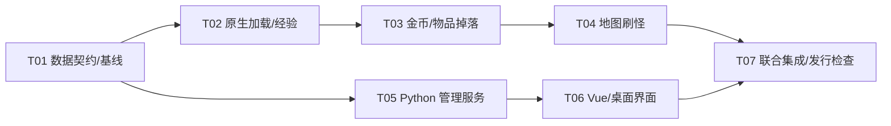

# Plan / 计划：玩法配置集中管理与运行时加载
最后修改时间: 2026-11-06 22:24:01

## Review status / 审查状态

Accepted，修订 2。用户已“采纳，拆分任务”，接受 JSON 配置方案并要求建立任务拆分。本次落实局部方案、依赖和协调记录；用户现已授权连续实施全部任务；遵循依赖逐项安排，中间只运行针对性检查，全部功能完成后再统一编译与打包制品。不含 Git 提交。

## Intent basis / 意图依据

- [意图](../intent/20261106-centralized-configuration-catalog.md)、[研究](../research/20261106-centralized-configuration-management.md)。
- 本期是打怪升级的玩法配置：经验、金币、物品掉落/爆率和刷怪；不含端口、并发、线程、构建/部署参数。
- 选定的数据由配置文件提供，游戏自己在启动时读取；GUI 管理数据，不要求热更新，不新增玩法参数，不改计算逻辑。
- 本修订围绕四类核心数据形成交付闭环。怪物战斗属性、装备/药水、商店/奖励、守卫放置继续保留在候选目录，不在本修订内实施迁移；扩展这些类别仍由用户决定。

## Technical decisions / 技术设计与决策

### 1. 配置格式和组织

玩法配置使用标准 UTF-8 JSON，C++ 用 `nlohmann/json`，Python 用标准库 `json` + Pydantic，Vue 用有类型的 DTO。选择理由是消费端以 C++ 为主、管理入口以 GUI 为主，JSON 类型和数组语义明确，三端均方便读取。模板的 YAML/Dynaconf 继续管理工作台自身设置，不与玩法数据混用。

本机 vcpkg registry 中可见 nlohmann-json 3.12.0 的 port，但项目 manifest 尚未引入；实现时仍使用项目固定 baseline 解析出的版本，不升级整个 registry。这里只确认包描述可用，尚未编译验证。

建议来源目录与安装后布局：

```text
server/config/gameplay/              # 源码中的权威玩法数据
  manifest.json                     # schema_version、掉落/刷怪文件索引
  monsters.json                     # 怪物 ID、名称和基础经验
  drops/<monster_id>.json            # 单怪物的有序掉落条目
  spawns/<map_id>.json               # 单地图的刷怪组和区域
  catalog.json                      # 从编译期记录导出的只读身份目录
  migration-notes.json               # 现存未生效项及来源，不参与运行计算

<install>/server/config/gameplay/    # 游戏读取相同布局
tools/gameplay-workbench/            # 基于现成模板的独立管理应用
```

文件按业务对象拆分，GUI 可按怪物/地图查询保存；不把每个数值拆成文件，也不把所有玩法数据混在一个巨型对象中。列表使用 JSON array，保留掉落和刷怪顺序；不依赖 object 的键顺序。

标准 JSON 不保存注释，字段说明、单位、约束与未使用标记放入管理元数据和 GUI；不引入 JSONC/JSON5 或跨语言注释扩展。文件统一缩进、换行和稳定输出，保存不自动排序有业务语义的数组。

### 2. 数据结构与字段边界

| 数据 | 拟迁移字段 | 身份与约束 |
| --- | --- | --- |
| 怪物经验 | `exp` | `monster_id` 为现有编译期 ID，`monster_name` 是校验/显示标签；exp 为非负 C++ int 范围整数，覆盖所有有效怪物 ID，包括旧默认 0 |
| 掉落 | `group`、`prob_recip`、`repeat`、`count` 及既有怪物/物品关联 | 保留原行语义及组内顺序；运行条目 group >= 0，其余三值 >= 1；概率分母映射原 probRecip，不改成最终百分比 |
| 刷怪 | 怪物关联及 `x/y/w/h/count/time` | 使用现有 map_id/monster_id；坐标和数量保持原单位，w/h/time > 0，count >= 0；count=0 沿原计算，不能暗示关闭 |
| 已有未使用字段 | `cratio` | 原值保留、只读展示为“当前未消费”，不接线为生成概率 |

顶层使用 `schema_version=1`，属于文件格式元数据，不是新玩法参数。身份目录使用数字 ID 和名称组合：怪物表存在重名，不能将名字作为经验配置的唯一键。配置中的 ID/标签必须与对应游戏的编译期记录一致；不重排 ID、不修改资源关联。

原生和 Python 均拒绝未知键、重复对象键、重复身份、非整数数值、越界值及运行条目中的未知引用。不会让 Python 自动把字符串或 bool 转成整数。版本化 JSON Schema 固定在 `server/config/gameplay/schema/`，由 T01 按下述数据形状落实，用于说明和基础约束；Pydantic 与 C++ 实现通过共用样本核对。ID 引用与分组等领域校验仍明确实现，C++ 不增加通用 Schema 引擎。

### 2.1 跨任务固定接口

以下为修订 2 的输入输出约定，各任务据此实现，不将接口设计留给下游自行决定：

| 文档 | 顶层/条目形状 |
| --- | --- |
| manifest | `{schema_version:1, drop_monsters:[id...], spawn_maps:[id...]}`；数字索引与文件名一致，禁止重复索引及缺文件 |
| monsters | `{schema_version:1, monsters:[{monster_id,monster_name,exp}...]}`；按现有 ID 覆盖所有有效怪物 |
| 单怪物 drops | `{schema_version:1, monster_id,monster_name,items:[{item_id,item_name,group,prob_recip,repeat,count}...]}` |
| 单地图 spawns | `{schema_version:1, map_id,map_name,groups:[{monster_id,monster_name,loc:[{x,y,w,h,count,time,cratio?}...]}...]}`；允许重复怪物组，不按怪物 ID 去重 |
| catalog | `{schema_version:1, monsters:[{id,name}...], items:[{id,name}...], maps:[{id,name}...]}`；名称可重复，数字身份唯一 |
| migration-notes | `{schema_version:1,source_revision,records:[{domain,source_path,source_position,raw,reason}...]}`；只读来源记录，不进入游戏计算 |

Schema 描述见相应 `*.schema.json`，原始与有效数据导出证据见 T01 的交付记录。Schema、catalog 和迁移说明不成为运行参数；运行时只按 manifest 指定的领域文件构表。

C++ 加载模块的对外合同：`GameplayConfig::load(root)` 返回完整配置；`monsterExp(monsterID)` 返回经验；`monsterDropTable(monsterID)` 返回原 `std::map<int,std::vector<DropItemConfig>>` 形态且已按 repeat 展开；`mapSpawns(mapID)` 返回有序的 SpawnGroup/SpawnRegion 类型容器。未配置掉落的有效怪物返回空表，未列入刷怪索引的有效地图返回空组；未知身份报错。加载后不修改快照。

`Server::initializeGameplayConfig(root)` 只允许初始化一次，`Server::gameplayConfig() const` 提供只读引用，未初始化不得使用。地图宿主函数固定为 `getMapSpawnConfig()`：以当前地图 ID 查快照，每次构造独立 Lua table，结构恢复为原 monGener 输入的 `name/loc` 字段。

Python 使用独立 WorkspaceService 与 GameplayConfigService；桌面选择目录后显式绑定一个 workspace，所有业务请求携带 workspace_id，切换目录后旧请求不得写入新目录。模板浏览器开发与测试模式从应用自身设置传入隔离目录，不将根路径变成玩法参数。

API 固定如下：

| API | 请求与结果 |
| --- | --- |
| `GET /api/gameplay/workspace` | 当前已绑定 workspace 元数据，或明确的未绑定状态 |
| `GET /api/gameplay/catalog` | workspace_id、catalog_revision 和只读身份/字段说明/未生效记录 |
| `GET /api/gameplay/config` | query 为 workspace_id、domain、object_id；返回相同定位、文件字节 SHA-256 revision、原始结构 data；monsters 使用整个文档，其余定位单个 ID |
| `POST /api/gameplay/config/validate` | body 为上述定位、catalog_revision、data；200 返回 valid 与带字段路径的 issues；请求格式错误沿模板 422 契约 |
| `PUT /api/gameplay/config` | body 增加读取时的 revision；完整校验后保存并返回新 revision/data；外部修改/目录切换/目录版本变化返回 409，非法数据返回 422 |

domain 仅为 monsters/drops/spawns，monsters 的 object_id 省略。API 错误沿模板 `{code,error,requestId}`，issues 是显式校验接口的业务结果，不更改模板通用错误格式。GET 不使用启动配置缓存代替文件重读；身份字段根据 catalog 核对，有顺序的数组按原顺序保存。

### 3. 迁移基线与未生效数据

本次只读词法检查的规模：怪物记录有 364 个 name 声明、359 个显式 exp 赋值；掉落表 5,272 行均符合现有字面量格式；251 份地图脚本有实际 monGener 调用，其表可解析为 2,082 个怪物组、3,328 个区域，含 24 个 cratio。其余四个地图目录 Lua 是 helper/default 和两个无刷怪调用文件。以上不是编译后的行为证明，不能代替迁移检查。

发现的现存差异：

- 怪物名称“未知”出现多次，因此经验按原数字 ID 导出，遗漏 exp 的记录显式保留原默认 0。
- 掉落有 14 个怪物名、4 个物品名不匹配当前名称声明，涉及 386 行；刷怪有 6 个怪物组使用两个未匹配名称。最终是否无效，以实际 `DBCOM_*` 解析和旧生产过滤结果复核。
- 八份地图的刷怪表中同一怪物出现多组，迁移不得按名字合并；区域列表和重复条目同样保留。

实施首先从冻结版本导出旧有效结构与全部原始声明，记录来源及过滤原因。已证实旧代码不会使用的条目原样放入 migration-notes，只读可查看，不删除、不启用，也不让它们导致有效配置启动失败。新运行配置仅包含经证实有效的部分，新增未知引用仍报错；这是一份明确的数据划分，不是运行时兼容兜底。只有实际解析证据支持的条目才可如此归类；未能确认的条目由主会话裁决，不由实现者猜测。

首次迁移只改变保存和读取方式，初始经验、掉落与刷怪值不调优。以后用户在 GUI 调数值属于正常配置编辑。对不支持表达式、未确认引用或不一致记录，停止相应迁移并报告，不猜测或批量改名。

### 4. 游戏读取与消费

- `GameplayConfig` 负责文件解析、校验、身份绑定和构建不可变快照；由 `Server` 持有，初始化一次。默认路径沿用当前服务端以工作目录定位 script/map 的方式，为 `config/gameplay`，测试可直接向加载器传入隔离目录；本修订不改网络或线程参数。
- master/slave 两条 main 路径在日志可用后、创建 actor 执行者前完成配置校验。缺失/非法文件返回非零并给出文件/字段原因，不发布半份快照，不默默使用旧源码值。
- 所有领域在本次进程启动时取得同一批完整数据。后续新地图从此快照创建自己的 Lua table，不在一个进程中混读不同磁盘版本；保存后重启才加载新值，本期不提供 reload。
- 经验仅替换 `Monster::dispatchOffenderExp()` 的基数来源，保留伤害占比、过期伤害归属、最低经验和取整。移除已迁移的 `.exp` 静态数值及其旧消费者，身份数组顺序不变。
- 掉落把从 `.inc` 构表改为从配置构表；继续使用现有按 group 组织的结构和生产抽样路径，保持 repeat 展开、金币拆分、原倍率与随机波动。旧 `.inc` 不再作为运行时来源。
- `ServerMap::LuaThreadRunner` 提供 `getMapSpawnConfig()`，返回当前地图的新 Lua table；地图脚本只将原字面量参数换成此调用，原守卫代码、协程和 main 不变。monGener 的 uidList/lastUpdateTime/gridCount 只写地图实例副本，不写持久配置或共享快照。
- 地图有效格数和区域可行性仍按旧函数处理；不以新几何校验擅自修正坐标或改掉原有过滤。文件结构、整数范围和引用错误提前报告。

数据快照属于各服务端进程；本期不增加节点配置同步协议。相同游戏节点应使用相同发布的数据，本计划只检查 master/slave 都能读同一输入，不宣称强制跨节点一致。

### 5. 管理应用

复制模板的必要源码、锁文件和工程配置到 `tools/gameplay-workbench`，包名收敛为 `mir2x_workbench`；不复制外部开发环境、构建产物和运行日志，不修改模板仓库。

应用选择一个明确的源码 server 目录或已安装 server 目录作为管理根。Python 业务层限定读写 gameplay 布局，页面发送领域/对象 ID，不发送任意 shell 命令。读取 catalog 显示现有怪物、物品和地图，显示 migration-notes 中的未生效记录。

API 按“跨任务固定接口”实现。配置请求使用明确的 workspace、domain、对象 ID、data；保存附带读取版本 revision，失败沿模板 `{code,error,requestId}` 契约返回。

三个主要视图是怪物经验列表、按怪物的金币/物品掉落表、按地图的刷怪区域表。字段说明和未使用标记可见，基础概率分母与最终实际爆率分开解释。列表搜索/排序不改底层掉落顺序；本修订主要编辑既有条目，不提供新建怪物/物品/地图身份或拖拽重排。

每个文件保存前完整校验；使用文件字节 revision 检测外部改动，应用内部串行保存，先备份、同目录临时写入再 replace。冲突返回 409 并保留用户草稿。任意外部编辑器不遵守应用锁时，检查与 replace 之间仍有竞争窗口，按单写者使用，不宣称文件系统提供通用 CAS。

按单文件保存，不提供跨怪物/跨地图事务或全局自动保存。GUI 显示“已保存，下次启动生效”；不猜当前进程值、不自动重启游戏。模板通用 shell 示例不接入配置保存业务。

### 6. 数据安装与维护权威

新安装同时交付 gameplay 文件、catalog 和说明；已有 gameplay 目录整体保留，安装不得无提示覆盖用户调整。目录存在但缺文件或结构不匹配时显式报告，不把新旧默认混合成一批配置。替换数据应经用户显式选择并保留原目录。

编译期身份目录由小型原生导出工具生成，包含 ID/名称，不包含已迁移玩法值。旧怪物/掉落/刷怪生成工具的输出须退出权威维护链：怪物 CSV 工具不再产生已移除的 `.exp`；旧 dropgen/monstergen 仅作为历史输入参考并明确不再写当前权威配置/地图脚本。本期不重建缺失的外部 MonItems/Mon_Def 导入工作流。

## Implementation steps / 实施步骤

| 顺序 | 主要结果与修改 | 完成条件 | 意图归属 |
| --- | --- | --- | --- |
| S1 数据契约与基线 | 冻结旧值，核实际 ID/过滤结果，定义 JSON 模型、manifest、身份目录和未生效项；导出初始配置 | 原始总数 = 有效迁移数 + 保留未生效数；经验含默认值；掉落/刷怪顺序完整，迁移初值无玩法调优 | A01-A05、A07 |
| S2 原生加载与经验 | 增加原生 JSON 依赖和 GameplayConfig；接主从启动路径、配置失败退出、经验消费 | 游戏不依赖 GUI 即可加载；旧 ID 不变；只替换经验输入，启动前校验完整快照 | A04、A07 |
| S3 掉落接入 | 从 JSON 构建有效掉落表，删除运行时 `.inc` 来源 | 有效表与旧表逐条一致，repeat/group/金币路径保持；非法新引用不进入游戏 | A03、A05 |
| S4 刷怪接入 | 导出并替换 251 份脚本中的纯数据参数，增加宿主取表入口，保留 cratio/未生效说明 | 每份旧表与对应新表可对账；guard/main/协程不变；两地图实例状态互不污染 | A01、A05 |
| S5 配置工作台 | 引入模板，完成 Python 校验/保存 API 和三个 Vue 视图 | 可读取、编辑、预览、保存再读；拒绝非法数据，外部冲突保留草稿；未生效项可查看 | A06、A07 |
| S6 集成与发行 | 安装配置/目录说明、构建工作台目录包、旧生成链说明及联合检查 | 保存后的配置由原生重新加载，核心值可验证；离线使用 GUI 不依赖游戏运行；已有配置不被安装覆盖 | A01-A08 |

上述为交付里程碑。修订 2 将 S5 拆成 Python 管理服务与 Vue/桌面界面两个任务；依赖以任务定义表为准。S1 数据契约接受后，原生链与管理应用链可分别安排，最终由联合任务验证闭环。初值或接口差异必须先查明，不能带着差异放行下游。

## Files to change / 修改范围

- 新增 `server/config/gameplay/`、`server/src/gameplayconfig.{hpp,cpp}`；修改 `server/src/main.cpp`、`server.{hpp,cpp}`、`monster.cpp`、`dropitemconfig.cpp`、`servermap.cpp` 及对应构建定义。
- 修改 `common/src/monsterrecord.hpp`、`monsterrecord.inc` 中已迁移 exp 部分；不改变其他字段、顺序或 ID 分配。原生成器和相关知识文档同步维护说明。
- 新增目录导出/迁移用工具；只处理既有身份和数据，不形成旧/新并存的产品加载器。配置模块应可独立测试；必要时在 server 构建中拆为独立 library，避免测试必须启动整个服务。
- `server/script/map/*.lua` 仅替换 monGener 的数据实参；`addmonster.lua` 算法保持原样。
- 新增 `tools/gameplay-workbench/`；原生测试位于 `server/test/unit` 并沿用 Catch2/CTest，Python/Vue 测试沿用模板入口。
- `vcpkg.json`、`cmake/Mir2xDependencies.cmake` 仅为原生 JSON 读取依赖接线；`server/src/CMakeLists.txt` 等仅增加本功能编译、安装与检查入口。这不是基础设施参数配置化。

## Tasks and coordination / 子任务与协调

### Coordination / 协调信息

- 方案修订：2。
- 权威协调根：`D:/SourceCodes/opensource/mir2x`；权威总计划为本文件。
- 仲裁会话：本主会话，唯一更新分配、执行状态和接受结论。
- 阶段授权：用户“采纳，拆分任务”，覆盖方案接受与任务拆分；后续用户已明确“开始实现，全部完成之后再去编译制品，中间只针对性测试”，覆盖全部七任务连续实施和最终验证/构建；没有 Git 写入或现场操作授权。
- 代码工作区：尚未分配；未来派发时绑定实际工作区及已接受前置版本，分支内计划副本不产生执行权。

### Task definitions / 任务定义表

| ID | 任务文档 | 直接前置任务与要求 | 预期交付与验收 | 意图验收归属 |
| --- | --- | --- | --- | --- |
| T01 | [数据契约与迁移基线](../task/20261106-centralized-configuration-catalog/T01-data-contract-baseline.md) | 无；执行前绑定原始源码基线与现有工作区保护范围 | 固定 Schema/样本、实际身份目录、初始 JSON 和原始/有效/未生效对账；不切换游戏消费 | A01-A05、A07 |
| T02 | [原生加载与经验](../task/20261106-centralized-configuration-catalog/T02-native-loading-experience.md) | T01 的契约、初始文件和实际基线交付已接受 | 完整不可变快照、主从初始化、经验消费、非法输入非零退出、身份不变 | A03、A04、A07 |
| T03 | [金币与物品掉落](../task/20261106-centralized-configuration-catalog/T03-loot-integration.md) | T02 原生接口与主从初始化交付已接受 | 原掉落生产路径改读配置；展开后的有效表与基线一致，金币/组内顺序保持 | A03、A05 |
| T04 | [地图刷怪](../task/20261106-centralized-configuration-catalog/T04-spawn-integration.md) | T03 交付已接受，继承完整快照与原生基线 | 独立 Lua table、地图纯数据实参替换、原算法和实例隔离，全部迁移表对账 | A01、A03、A05 |
| T05 | [Python 配置管理服务](../task/20261106-centralized-configuration-catalog/T05-workbench-service.md) | T01 的契约、catalog、初始文件和共享样本已接受 | 模板工程、类型校验、workspace 与版本保护、预览/保存服务、实际 API 检查 | A06、A07 |
| T06 | [Vue 与桌面管理界面](../task/20261106-centralized-configuration-catalog/T06-workbench-ui.md) | T05 实际 API、目录选择桥接和检查交付已接受 | 三类配置视图、字段反馈、差异/冲突/草稿、未生效记录、桌面离线编辑 | A06、A07 |
| T07 | [联合集成与发行检查](../task/20261106-centralized-configuration-catalog/T07-integration-release.md) | T04 和 T06 均已接受，实际版本可访问且可合并 | 成套数据安装、已有值保护、源码/目录包检查、GUI 保存到原生读取闭环及验证记录 | A01-A08 |

### Execution registry / 执行登记表

| ID | 执行状态 | 执行者 | 分配编号 | 工作基线 / 交付位置 | 仲裁结论 / 当前阻塞 |
| --- | --- | --- | --- | --- | --- |
| T01 | accepted | 主会话 | CONFIG-T01-01 | 当前工作区；baseline.json 与初始 JSON/Schema/契约样本 | 3 项迁移对账通过；实际生产展开 5402 项逐项相等，原值未调优 |
| T02 | accepted | 主会话 | CONFIG-T02-01 | 当前工作区，前置交付已接受 | 配置模块定向3case/386assertions通过；主从启动与经验接线已审，client/server制品编译按用户要求延后 |
| T03 | accepted | 主会话 | CONFIG-T03-01 | 当前工作区；T02完整快照 | 生产抽样函数逐字保持，5402展开表已通过实际原生对照；最终成套编译延后 |
| T04 | accepted | 主会话 | CONFIG-T04-01 | 当前工作区；251纯数据实参/独立Lua table | 定向2case/34308assertions通过；原monGener实际执行；原表/非数据片段对账3项通过 |
| T05 | accepted | 主会话 | CONFIG-T05-01 | 当前工作区；用户scaffold提交0d1065c已确认 | 管理API/目录绑定/备份冲突与桌面20项定向通过，Mypy/Ruff通过；最终发行检查归T07 |
| T06 | accepted | 主会话 | CONFIG-T06-01 | 当前工作区；T05正式API | 9项Vue定向通过，lint/typecheck/format通过；实际窗口与发行闭环归T07 |
| T07 | accepted | 主会话 | CONFIG-T07-01 | 当前工作区；final-manifest.json与verification | 原生129/Python64/Vue37、26契约/安装4场景及干净发行闭环通过；真实窗口目视未验证，明确保留 |

### DAG and integration / DAG 与集成



- 数据契约和初值只由 T01 写入；接受后冻结，消费任务不随意改数值。发现契约问题由主会话修订，复核已接受下游。
- 原生共享文件和 CMake 按 T02 → T03 → T04 串行。T05/T06 依次拥有管理应用，T05 完整引入模板后 T06 才修改界面。
- 两条链在依赖满足且用户另有执行安排时可隔离工作；本次不启动子 agent 或外部会话。T05 不写原生/权威数据，原生任务不写管理应用。
- T07 是最终共享集成写入者，消费准确交付版本并完成安装/发行接线；不能用未审工作树或上游自报通过放行。
- 派发时指定可写 task 回报位置与有效编号；每次交付须包含实际 diff/版本、输入、检查结果、未运行项及风险。主会话审查后才将状态置为 accepted。

### Assignment history / 分配历史

| 时间 | ID | 分配编号 | 执行者 | 动作与依据 |
| --- | --- | --- | --- | --- |
| 2026-11-06 20:28:00 | T01-T07 | 无 | 无 | 用户采纳并要求拆分，建立方案修订 2；未分配或启动实施 |

## Verification plan / 检查与验证安排

| 检查 | 方法与实际证明 |
| --- | --- |
| 初始数据一致 | 旧生产代码导出的有效结构与新加载结果逐字段比较；无效项单独对账，不用词法计数代替真实 ID 解析 |
| 身份和范围 | 比较迁移前后全部怪物/物品/地图 ID 与名称；检查 diff 只有所选玩法字段/加载路径，公式与网络协议不变 |
| 原生加载 | Catch2 覆盖完整数据、缺文件、越界/类型错误、重复 ID、未知引用、未完成快照不发布及主从初始化；不穷举无关失败 |
| 经验/掉落生产消费 | 验证更改输入配置确实改变生产读取结果；有效掉落有序结构对照、probability=1 的确定性组内/重复/金币例；不使用不稳定的随机频率阈值作为通过条件 |
| Lua 刷怪 | 对全部已迁移表比较纯数据；实际运行原 monGener 并提供隔离地图/时间/怪物函数，核原周期、数量上限和实例状态隔离；不只测试一个重写的计算函数 |
| Python/原生契约 | 同一批合法与关键非法 JSON 输入分别经过 Pydantic 和原生加载器，结果一致；不能以 GUI 校验通过代替游戏校验 |
| 工作台 | pytest 验证实际读取/校验/保存/外部冲突；Vitest 验证主要表单、数组顺序和保存反馈；打包后读写临时副本，不访问运行服 |
| 最终闭环 | GUI 保存临时数据 → 原生加载同一目录 → 验证选定值；再确认旧 ID/算法保持，现存配置在重新安装时保留 |

原生沿用 `cmake --build <builddir> --target <受影响测试目标>` 与 `ctest --test-dir <builddir> -R <本功能前缀> --output-on-failure`。修改公共记录后构建 client/server；最终按影响范围运行现有 `check`，仅对失败或后继改动补跑，不反复累计历史数字。

工作台沿用模板 `make check`、`make test`、`make binary`；前端修改运行 `corepack yarn lint:fix`、`corepack yarn typecheck` 并完成模板格式检查。阶段结果、命令和输入版本分别记录，打包检查对应准确发行产物。初始规划时尚未执行；实际检查与后继修复记录在各task及最终verification。

## Risks and recovery / 风险与恢复

- 数据和加载器必须成套切换。旧版本恢复时恢复配套旧数据与源码，不给新程序补一条悄悄读取旧 `.inc` 的路径。
- 无效名称、重名、遗漏默认值及重复刷怪组是当前已知迁移风险，S1 逐项对账；不在迁移时顺便修数据或修未接入倍率。
- 原生整数与 JSON/Python 数值必须在共同范围内，GUI 禁止浮点、NaN 等进入整数领域；名称按 UTF-8 精确匹配。
- GUI 备份和原始迁移清单保留，数据恢复不涉及角色数据库。多文件编辑在游戏启动前完成，保存失败明确给出文件状态。
- JSON 配置和任务方案已接受；未能确认的旧无效项仍需按证据裁决，不自动启用或删除。需要增加相邻玩法字段时修订计划，不在既有任务中临时扩展。

## User review notes / 用户审查记录

- 用户已要求进入计划，并进一步询问 C++ 友好、方便管理应用读取且有组织的配置形式；本修订据此优先推荐标准 JSON，替代研究早期因模板而优先 YAML 的建议。
- 用户随后“采纳，拆分任务”，修订 2 将方案置为 Accepted，并形成七项局部方案、依赖和共享写入安排；不等于七项产品任务已经执行。
- 拆分时全部未分配；随后用户授权全部实施，当前状态以执行登记表和下述实施记录为准。没有启动子 agent 或外部会话。
- 初始规划阶段仅调查；当前已进入实施与最终验证。未启动游戏，未 stage/commit。

## Implementation authorization / 实施授权补充

- 2026-11-06 20:51:12：用户授权全部实现，功能完成后统一构建制品；中途仅针对性测试（含必要的隔离迁移/测试探针，不构建发行制品）。
- GUI 模板已由用户复制到 `tools/gameplay-workbench`，项目重命名、依赖与真实 uv.lock 更新由主会话负责，不覆盖重拷。
- T01 分配 CONFIG-T01-01 给主会话，当前工作区实施，保护已有文档。后续节点在前置证据接受后登记；不启动额外会话。

- 2026-11-06 20:59:47：T01 CONFIG-T01-01 交付已审：364 怪物；5272 掉落=4886 有效+386 未生效；有效展开5402与原函数相同；251 地图、2082组含6未生效、有效3322区域及24 cratio。`python tools/gameplayconfig/migration/test_baseline.py` 3/3通过。冻结输入与原生产结果见 migration/baseline.json，原始编译命令/TSV见 build/gameplay-baseline（隔离探针）。接受后主会话接收 T02 CONFIG-T02-01；全部制品构建仍延后。

- 2026-11-06 21:05:11：T02实际隔离编译配置测试并运行，3case/386assertions全部通过（build/gameplay-baseline/test_gameplayconfig.exe）；主从初始化在actor前且失败EXIT_FAILURE，迁移359个显式exp并保持记录顺序。接受针对性交付，完整client/server构建按用户要求留到最终。主会话接收CONFIG-T03-01。

- 2026-11-06 21:05:11：T03生产掉落抽样函数自 `getMonsterDropItemList` 起与HEAD逐字相同，只切配置表来源；采用已通过的原生有效表对照，主会话接受。接收CONFIG-T04-01与CONFIG-T05-01，均由同一主会话串行写入。

- 2026-11-06 21:14:29：T04配置转换与真实Lua消费2case/34308assertions通过；迁移核对3项通过，251脚本纯数据实参外的prefix/suffix散列全部保持。接受针对性交付，成套制品留到最终。

- 2026-11-06 21:49:52：恢复会话已核用户确认scaffold提交 `0d1065c1db45bdbfd0378ad21b1be4e9b2e57eb9` 是预期基线；保护全部在途实现。补齐登记：T05主会话实现并审查20项API/desktop定向与Mypy/Ruff；T06主会话CONFIG-T06-01，9项Vue定向及lint/typecheck/format已通过。两项接受后由同一主会话接收CONFIG-T07-01。此前T06及T07准备源码已在在途工作树，未另派或并行写入，现补记准确事实；最终发行检查才放行整体完成。新增Unicode CLI、生产drop与API→native/真实install组件用例属于既定验收；全部功能完成后才开始成套编译。

- 2026-11-06 22:19:31：T07联合验证发现原check中5项questscripts的Lua窄fopen不能读取实际存在的中文文件。原日志final-check.log保留；按既定验证修复授权，仅Windows测试夹具经std::filesystem UTF-8路径读入再交Lua load执行，merchant参数按UTF-8传递；不改任务/游戏Lua或生产加载。定向复验后再跑check。跨语言共用反例扩充至26项，补掉落/刷怪类型、范围、引用与null边界；不改初值/协议。

- 2026-11-06 22:24:01：CONFIG-T07-01最终交付审查接受（源码/自动化/发行）。client/server/tool及GUI成套编译完成；native check129/129=33.26s，Python64=21.23s；共用契约扩充后affected11=18.34s；Vue37=1.53s；真实干净wheel HTTP三域→native与EXE/主从缺配置检查通过。两处Windows旧测试夹具适配后5项复验及全129通过。窗口目视因浏览器/native控制通道不可用未验证，不称GUI点击通过；完整证据、制品hash、边界见[Verification](../verification/20261106-centralized-configuration-catalog.md)。T01-T07全部直接交付，无新Git提交/运行服安装/角色操作。
