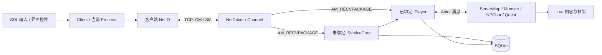

# 代码地图
最后整理日期: 2026-11-05

[返回知识库](README.md)

## 顶层目录

| 路径 | 职责 | 常见修改 |
| --- | --- | --- |
| [client/src](../../client/src) | SDL3 客户端、界面状态、输入、动画与网络呈现 | 窗口、控件、操作和消息显示 |
| [server/src](../../server/src) | FLTK 管理界面、Actor 运行时、业务与 SQLite 持久化 | 权限、角色状态、战斗、交易与脚本 API |
| [common/src](../../common/src) | 两端共用的协议、业务数据、静态定义与工具类 | 消息、物品/地图/技能定义、序列化 |
| [server/script](../../server/script) | 地图、NPC、任务及脚本 API | 游戏内容和剧情 |
| [tools](../../tools) | 地图编辑、资源转换、打包、数据转换等工具 | 素材管线 |
| [cmake](../../cmake) | 依赖、资源、测试和编译器接入 | 构建系统 |
| [ports](../../ports) | vcpkg overlay ports | 项目额外依赖的构建适配 |
| `common/test`、`server/test`、`client/test` | 各模块 Catch2/Lua 测试 | 与相应业务一起修改 |
| [test](../../test) | 总测试说明与跨模块集成测试入口 | 多模块场景；当前跨模块集成目录尚未注册用例 |
| `build/`、`install/`、`vcpkg/`、`.vcpkg/` | 本机生成目录和缓存 | 不作为业务源码编辑入口 |

## 运行时分工



这是主要责任示意，不表示所有数据库操作只经过图中的两条箭头。NPC、Quest 和其他数据库模块也会访问持久化。

### 客户端

| 入口 | 作用 |
| --- | --- |
| [main.cpp](../../client/src/main.cpp) | 参数、日志、SDL 设备和资源 DB 初始化 |
| [client.cpp](../../client/src/client.cpp) | `Client::mainLoop()`、`initASIO()`、`onServerMessage()`、`switchProcess()` |
| [process.hpp](../../client/src/process.hpp) | Process 接口与页面/运行状态 ID |
| [processlogin.cpp](../../client/src/processlogin.cpp) | 登录界面、`sendLogin()` |
| [processselectchar.cpp](../../client/src/processselectchar.cpp) | 查询角色、创建/删除入口和 `onStart()` |
| [processrun.cpp](../../client/src/processrun.cpp)、[processrunnet.cpp](../../client/src/processrunnet.cpp) | 进入地图后的输入、界面和网络行为 |
| [netio.cpp](../../client/src/netio.cpp) | 连接、收发、包解码与错误回调 |
| [myhero.cpp](../../client/src/myhero.cpp)、[clientmonster.cpp](../../client/src/clientmonster.cpp) | 玩家自身和怪物的客户端表现 |
| [guimanager.cpp](../../client/src/guimanager.cpp)、[gui](../../client/src/gui) | 运行中的复合界面；旧界面类也有很多直接位于 `client/src/` |
| [widget.hpp](../../client/src/widget.hpp)、[buttonbase.cpp](../../client/src/buttonbase.cpp) | 控件父子关系、ROI、焦点、事件与按钮状态 |
| [pngtexdb.cpp](../../client/src/pngtexdb.cpp)、[pngtexoffdb.cpp](../../client/src/pngtexoffdb.cpp) | 普通贴图与带偏移信息贴图的读取、缓存 |

客户端常见命名方式：`processxxx.cpp` 负责界面行为，`processxxxnet.cpp` 负责该状态下的 `on_SM_*`。全局消息分派位于 `Client::onServerMessage()`；只增加一个页面成员函数不会自动接入消息。

### 服务端

| 入口 | 作用 |
| --- | --- |
| [main.cpp](../../server/src/main.cpp)、[server.cpp](../../server/src/server.cpp) | 主/从节点启动、GUI、数据库初始化与 `Server::launch()` |
| [actorpool.cpp](../../server/src/actorpool.cpp) | mailbox 调度、线程和任务窃取、网络驱动启动 |
| [actorpod.hpp](../../server/src/actorpod.hpp) | 单个 Actor 的消息处理、`post()`、`send()`、等待及网络绑定 |
| [dispatcher.cpp](../../server/src/dispatcher.cpp) | 向 Actor 地址投递消息 |
| [netdriver.cpp](../../server/src/netdriver.cpp)、[channel.cpp](../../server/src/channel.cpp) | 玩家 TCP 连接、收包和路由 |
| [actornetdriver.cpp](../../server/src/actornetdriver.cpp)、[peercore.cpp](../../server/src/peercore.cpp) | 服务端节点之间的连接与 Actor 消息；不是玩家连接入口 |
| [servicecore.cpp](../../server/src/servicecore.cpp)、[servicecorenet.cpp](../../server/src/servicecorenet.cpp) | 登录前业务、账号、角色查询、上线编排、地图和任务管理 |
| [serverobject.hpp](../../server/src/serverobject.hpp) | 服务端对象与 Lua runner 的共同基础 |
| [charobject.cpp](../../server/src/charobject.cpp)、[battleobject.cpp](../../server/src/battleobject.cpp) | 位置、移动及战斗对象的共同行为 |
| [player.cpp](../../server/src/player.cpp)、[playernet.cpp](../../server/src/playernet.cpp)、[playerop.cpp](../../server/src/playerop.cpp) | 玩家状态；分别集中对象行为、客户端请求、Actor 消息 |
| [servermap.cpp](../../server/src/servermap.cpp)、[servermapop.cpp](../../server/src/servermapop.cpp) | 地图占用、移动、观察者、地图脚本和 NPC 加载 |
| [monster.cpp](../../server/src/monster.cpp)、[monsterop.cpp](../../server/src/monsterop.cpp) | 怪物对象与消息；特殊怪物另有派生实现 |
| [npchar.cpp](../../server/src/npchar.cpp)、[npcharop.cpp](../../server/src/npcharop.cpp) | NPC 行为、脚本、交互与消息 |
| [quest.cpp](../../server/src/quest.cpp)、[quest.lua](../../server/src/quest.lua) | 任务 Actor、任务状态和 Lua 状态机框架 |
| [dbpod.hpp](../../server/src/dbpod.hpp)、[server.sql](../../server/src/server.sql) | SQLite 连接封装与初始表结构 |
| `*db.cpp` | 背包、金币、聊天、拍卖、交付、任务等持久化；函数应连同调用方事务一起阅读 |

`*op.cpp` 与 `*net.cpp` 是项目中的常见拆分习惯，不是强制所有业务类都采用的统一框架。

### 公共定义

| 文件 | 要寻找的内容 |
| --- | --- |
| [clientmsg.hpp](../../common/src/clientmsg.hpp)、[servermsg.hpp](../../common/src/servermsg.hpp) | `CM_*` / `SM_*` 消息号、固定消息结构与属性注册 |
| [msgf.hpp](../../common/src/msgf.hpp)、[zcompf.cpp](../../common/src/zcompf.cpp) | 消息类型、长度、响应位与压缩编码 |
| [serdesmsg.hpp](../../common/src/serdesmsg.hpp)、[sditem.hpp](../../common/src/sditem.hpp) | `SD*` 业务数据、序列化与物品实例 |
| [protocoldef.hpp](../../common/src/protocoldef.hpp)、[sysconst.hpp](../../common/src/sysconst.hpp) | 方向、职业、错误码和系统常量 |
| [uidf.hpp](../../common/src/uidf.hpp)、[uidf.cpp](../../common/src/uidf.cpp) | 运行时 UID 编码、分类与转换 |
| [dbcomid.hpp](../../common/src/dbcomid.hpp)、`*record.inc` | 编译期静态记录与名称到 ID 的查找 |
| [zsdb.cpp](../../common/src/zsdb.cpp) | 资源容器读写；与 SQLite 业务数据库是两种不同存储 |

## Actor 阅读时的约束

`ActorPool` 对同一个 mailbox 的 handler 执行做调度互斥，但不同 Actor 可以并行。`co_await` 或 Lua 远程调用会让当前逻辑等待，之后恢复时业务状态可能已经变化。

新增业务时，优先通过消息访问另一个 Actor 的状态，不要把对方对象指针当成普通同步对象任意修改。也不能把“单个 Actor handler 互斥”等同于“跨 Actor 操作天然是一个数据库事务”。

节点、线程和数据库并发的更深层保证需要针对具体调用链确认。本知识库没有把整个 Actor/SQLite 调度模型视为已经完成并发正确性审计。

## 常用定位命令

```bash
rg -n 'net_CM_BUY|CM_BUY' client/src server/src common/src
rg -n 'SM_ONLINEOK|postOnlineOK|on_AM_BINDCHANNEL' client/src server/src
rg -n 'tbl_inventory|dbUpdateInventoryItem' server/src
rg -n 'setQuestFSMTable|setQuestState' server/script/quest
```

先沿一条可复现流程追踪，再扩展到基础设施，通常比从 `actorpool.cpp` 的所有调度细节开始通读更有效。
