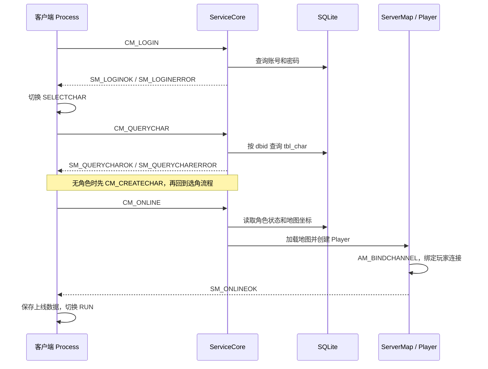

# 启动、登录与协议

[返回知识库](README.md)

## 服务启动不等于打开窗口

主节点的启动链路是：

1. [server/src/main.cpp](../../server/src/main.cpp) 解析参数、初始化日志、ActorPool、数据库封装和 FLTK 管理窗口。
2. 使用 `--auto-launch` 或在窗口中 Launch，调用 `Server::launch()`。
3. [server.cpp](../../server/src/server.cpp) 中的 `createDBConnection()` 打开工作目录下的 `mir2x.db3`，注册 SQL 函数；没有业务表时初始化默认数据库。
4. `loadMapBinDB()` 加载地图资源，`ActorPool::launch()` 启动业务运行时。
5. 单节点情况下，[ActorPool::launchBalance()](../../server/src/actorpool.cpp) 启动 worker、激活 `ServiceCore` 并启动玩家网络监听。
6. [ServiceCore::onActivate()](../../server/src/servicecore.cpp) 按配置预加载地图、等待地图激活，再加载任务脚本。

日志 `Master server listens players on port ...` 证明已经建立监听；它本身不证明所有地图和任务脚本都已完成业务初始化。遇到上线异常还应检查后续激活或脚本错误。

默认端口来自 [argf.hpp](../../common/src/argf.hpp)：玩家连接 **7000**，主节点供从节点接入的端口 **8000**。客户端连接玩家端口，不连接节点端口。

## 客户端状态

[ProcessID](../../client/src/process.hpp) 包含 LOGO、SYRC、LOGIN、CREATEACCOUNT、SELECTCHAR、CREATECHAR、CHANGEPASSWORD、RUN、CONNECTIONERROR、EXIT 等状态。其中 `SYRC` 是源码中的命名，不要自行把它改写成另一个枚举名。

入口 [main.cpp](../../client/src/main.cpp) 创建 SDL 设备与资源 DB；[Client::mainLoop()](../../client/src/client.cpp) 驱动输入、更新、绘制和状态切换。[Client::onServerMessage()](../../client/src/client.cpp) 把响应分派给当前状态。

收到网络包但页面没有响应时，需要同时检查全局分派和当前 Process；不能只看收包层是否正常。

## 注册与改密

| 步骤 | 注册 | 改密 |
| --- | --- | --- |
| 界面与本地校验 | `ProcessCreateAccount::doPostAccount()` | `ProcessChangePassword::doPostPasswordChange()` |
| 请求 | `CM_CREATEACCOUNT` | `CM_CHANGEPASSWORD` |
| 服务端 | `ServiceCore::net_CM_CREATEACCOUNT()` | `ServiceCore::net_CM_CHANGEPASSWORD()` |
| 成功响应 | `SM_CREATEACCOUNTOK` | `SM_CHANGEPASSWORDOK` |
| 失败响应 | `SM_CREATEACCOUNTERROR` | `SM_CHANGEPASSWORDERROR` |
| 数据 | `tbl_account` 新行 | 按账号、旧密码更新密码 |

实现依据：[注册界面](../../client/src/processcreateaccount.cpp)、[改密界面](../../client/src/processchangepassword.cpp)、[服务端账号处理](../../server/src/servicecorenet.cpp)。

当前账号规则由 [idstrf.cpp](../../common/src/idstrf.cpp) 定义：

- 普通注册要求邮箱形式的账号。
- 密码至少 8 字节，同时包含数字、小写、大写，以及 `~!@#$%^&*()` 中的特殊字符。
- 例如用于本机复现的账号可以采用 `dev@example.com`，密码形式可采用 `Mir2xDev1!`；这里不是要求使用固定测试凭据。
- `test / 123456` 来自初始化代码，登录处理刻意不再套用注册格式校验。因此默认测试账号可登录，不代表同样格式可自行注册或改密。
- 注册成功只创建账号，不自动创建角色，也不等于已经登录。

## 登录和进入地图

关键调用链：

| 环节 | 函数或文件 | 实际含义 |
| --- | --- | --- |
| 发登录 | `ProcessLogin::sendLogin()` | 发送账号密码 |
| 校验账号 | `ServiceCore::net_CM_LOGIN()` | 查 `tbl_account`，拒绝重复登录，登记 `channID -> {dbid, online=false}` |
| 登录回调 | `ProcessLogin::on_SM_LOGINOK()` | 只请求切换 SELECTCHAR |
| 选角页初始化 | `ProcessSelectChar` 构造函数 | 发送 `CM_QUERYCHAR` |
| 查角色 | `ServiceCore::net_CM_QUERYCHAR()` | 无角色响应 `QUERYCHARERR_NOCHAR`，这是正常业务分支 |
| 创建角色 | `ServiceCore::net_CM_CREATECHAR()` | 校验登录和角色信息，调用创建逻辑；不是注册接口的一部分 |
| 进入游戏 | `ProcessSelectChar::onStart()` | 有角色时发送 `CM_ONLINE` |
| 上线编排 | `ServiceCore::net_CM_ONLINE()` | 读取角色、定位基础地图，加载地图并创建玩家对象 |
| 绑定连接 | `Player::on_AM_BINDCHANNEL()` | 绑定 Channel，调用 `postOnlineOK()` |
| 真正进入运行态 | `ProcessSelectChar::on_SM_ONLINEOK()` | 保存 `SMOnlineOK` 并请求 RUN |

源码：[servicecorenet.cpp](../../server/src/servicecorenet.cpp)、[processloginnet.cpp](../../client/src/processloginnet.cpp)、[processselectchar.cpp](../../client/src/processselectchar.cpp)、[processselectcharnet.cpp](../../client/src/processselectcharnet.cpp)、[playerop.cpp](../../server/src/playerop.cpp)、[player.cpp](../../server/src/player.cpp)。

`--auto-login` 发送登录请求；查询到已有角色后，选角页还会自动尝试 `onStart()`。没有角色时不会凭空创建角色。

## 连接路由为什么会上下线切换

[Channel::forwardActorMessage()](../../server/src/channel.cpp) 先校验 `ClientMsg`，封装 `AM_RECVPACKAGE`：

- 未绑定 Player 时投递给 `uidf::getServiceCoreUID()`。
- 绑定后投递给该 Player UID，由 `Player::operateNet()` 和 `net_CM_*` 处理游戏内请求。
- 断线通知和解绑涉及 `AM_BADCHANNEL`、Player 下线与 ServiceCore 的登录登记清理。

如果登录阶段请求被错误地当成游戏内消息，或下线后出现重复登录，应沿 Channel 绑定和 `m_dbidList` 清理链路追踪，不能只修改界面提示。

## 三种消息边界

| 名称 | 使用位置 | 定义 |
| --- | --- | --- |
| `CM_*` | 客户端到服务端 | [clientmsg.hpp](../../common/src/clientmsg.hpp) |
| `SM_*` | 服务端到客户端 | [servermsg.hpp](../../common/src/servermsg.hpp) |
| `AM_*` | Actor 之间；也可经节点网络跨进程 | [actormsg.hpp](../../server/src/actormsg.hpp)、[actormsgpack.hpp](../../server/src/actormsgpack.hpp) |

`SD*` 是业务数据结构的常见前缀，不是第四套独立传输协议。复杂数据常通过 [cerealf.hpp](../../common/src/cerealf.hpp) 序列化，定义分布在 [serdesmsg.hpp](../../common/src/serdesmsg.hpp)、[sditem.hpp](../../common/src/sditem.hpp) 等文件中。

## 网络格式与兼容性

[msgf.hpp](../../common/src/msgf.hpp) 定义消息属性：

| type | 含义 |
| --- | --- |
| 0 | 空消息体 |
| 1 | 固定原始长度，使用 XOR 稀疏编码；不是网络加密 |
| 2 | 固定长度，直接发送 |
| 3 | 可变长度，可能为空 |

消息头最高位用于是否携带响应标识，实际消息号使用低 7 位。读取逻辑还涉及变长整数、mask 和原始长度；不要把所有消息都当作 `结构体大小 + payload` 直接读写。

固定结构可能直接按 `sizeof(T)` 和 `memcpy` 传输；复杂消息使用序列化。调整字段类型、顺序、结构布局或序列化顺序，都可能影响两端兼容性。

新增消息除了枚举和结构，还要维护 `_RSVD_register_clientmsg` / `_RSVD_register_servermsg` 属性表、发送方和对应的分派入口。消息号枚举的调整应当作协议变更处理。

## 构建签名的实际边界

[buildconfig.hpp.in](../../common/src/buildconfig.hpp.in) 生成 `getBuildSignature()`；[Client::onServerMessage()](../../client/src/client.cpp) 收到 `SM_BUILDVERSION` 时可以比较签名。

当前调研版本在 `server/src` 中未找到主动发送 `SM_BUILDVERSION` 的位置。因此不能把“没有版本报错”当成已经完成版本握手。两端配套构建，并保存提交、补丁和 EXE 哈希，才是当前本机验证中实际使用的来源依据。

`--disable-version-check` 只影响对应客户端检查，不能修复协议或数据布局不兼容。
